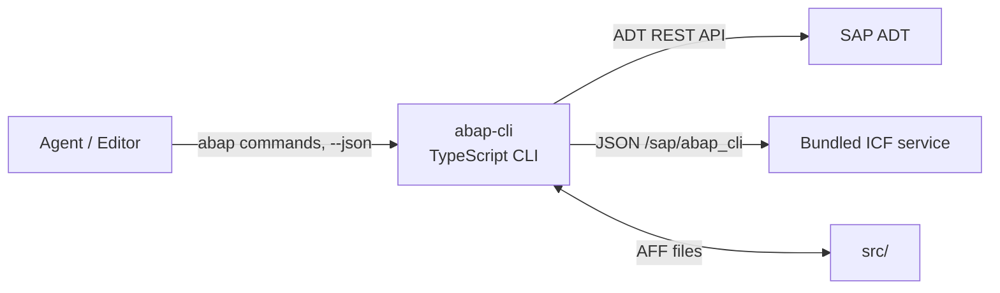

# abap-cli

> **Vibe coding for ABAP.** Edit ABAP like local files, sync it to SAP from the terminal, and let an AI agent run the whole loop.

<p align="center">
  <a href="https://github.com/chunrichi/abap-cli/actions/workflows/verify.yml"></a>
  <a href="LICENSE"></a>
  = 18" src="https://img.shields.io/badge/node-%3E%3D18-brightgreen.svg">
</p>

`abap-cli` turns SAP's ADT REST API — plus a bundled ABAP service for the endpoints ADT does not cover — into one command chain: pull → edit → check → push → run → verify. Every command speaks `--json` and publishes a `--schema` contract, and the package ships skills plus an agent definition, so an AI agent can drive SAP end-to-end without the GUI.

📖 **简体中文**: [README.zh-CN.md](README.zh-CN.md)

---

## Why abap-cli

A one-line ABAP change usually means: launch SAP GUI, open SE80, hunt for a transport, lock the object, edit, activate, unlock. Five minutes per loop, and any failed step starts you over.

`abap-cli` compresses it to two commands:

```bash
abap pull ZCL_MY_CLASS                                  # class + source parts → src/
# edit src/zcl_my_class.clas.abap in your editor
abap push src/zcl_my_class.clas.abap --tr DEVK900001    # lock → write → activate → unlock
```

Because every command speaks `--json`, an agent can run the same loop unattended — `pull` → edit → `check syntax` → `push` → `run` → verify — and recover from failures through stable error codes instead of parsing prose.

### Replaces GUI round-trips

| Task | Instead of | Use |
|---|---|---|
| Edit code in your own editor | SE80 | `abap pull` / `abap push` / `abap diff` |
| Syntax check without activating | SE80 + activation | `abap check syntax` |
| Query table data | SE16N / SE16H | `abap select` |
| Inspect table fields | SE11 | `abap fields` |
| Create classes, programs, DDIC objects, SICF nodes | SE80 / SE11 / SICF | `abap create` |
| Manage transport requests | SE01 / SE09 / SE10 | `abap transport` |
| Run a class or a report | SE24 / SE38 + debugger | `abap run` / `abap run-report` |
| Read runtime dumps | ST22 | `abap dumps` |
| Resolve a transaction code | SE93 | `abap tcode` |
| Check references before a refactor | where-used lists | `abap where-used` |

### More than a thin API wrapper

If you would otherwise script the ADT REST API yourself, `abap-cli` packages the parts you would have to build: transport resolution, the lock → write → activate lifecycle, the abap-file-format local layout and its schema validation, a unified JSON/exit-code contract, and a bundled ABAP service for DDIC, table data, reports, MIME and textpool reads that the standard ADT API does not expose. The ADT layer is the same one the [`abap-adt-api`](https://www.npmjs.com/package/abap-adt-api) Node SDK uses.

---

## What you can do

- **Edit in place** — `pull` any object into an abap-file-format tree, edit it with your editor, `push` it back with lock → write → activate → unlock. `check` and `diff` before you write.
- **Cover 21 object types** — classes, interfaces, programs and function groups; DDIC tables, structures, domains, data elements, lock objects and number ranges; SICF nodes and transaction codes; table types, message classes, CDS views and the CDS / RAP companions. Nineteen support create / pull / push; `BDEF` is pull / push and `SRVB` metadata-only.
- **Read SAP safely** — `search`, `inspect`, `where-used`, `tcode`, `list`, `dumps`, `fields`, `select` and `run-report` never change the system.
- **Run and verify** — `abap run` executes a class (classrun) or a PUBLIC STATIC method; `abap run-report` returns list output; `abap select` is the SE16N equivalent.
- **Manage transports** — `transport list / create / show / resolve / assign`, with per-object resolution during `push`.
- **Hand it to an agent** — `--json` and `--schema` on every command, categorized exit codes, and bundled skills + agent context installed with `abap init --agent`.

---

## Install

Requirements: **Node.js >= 18**; an SAP system with the **ADT service** enabled; a user with developer authorizations (create / change / activate repository objects).

```bash
npm install -g abap-cli
abap --version
```

From source:

```bash
git clone https://github.com/chunrichi/abap-cli.git
cd abap-cli
npm install
npm run build
node dist/index.js --help
```

---

## Quick start

```bash
# 1. Store a connection profile (the password goes to the OS keychain, not into project files)
abap profile add DEV --url https://sap.example.com:44300 --client 100 --username DEVELOPER --password '***'

# 2. Bind this workspace to the profile
abap init --profile DEV --yes
abap doctor                       # environment + config diagnostics

# 3. Pull, edit, push
abap pull ZCL_MY_CLASS
# edit src/zcl_my_class.clas.abap
abap push src/zcl_my_class.clas.abap --tr DEVK900001

# 4. No open transport? Create one
abap transport create "Feature work" --yes --json
```

In a terminal, a bare `abap init` opens the interactive wizard instead.

### Enable the DDIC, data and runtime endpoints

Source pull / push / check work against ADT alone. DDIC CRUD, SICF node and transaction-code operations, `select`, `fields`, `run-report`, `tcode`, `mime`, `run --method` and `pull --remote` use the bundled ICF service under `/sap/abap_cli`. Install it once per system:

```bash
abap deploy --yes      # 3 global classes into $TMP — no transport needed
abap deploy status     # confirm the installed version matches this CLI
```

For a transported install into your own package, pass `--package <pkg> --tr <request>`.

### Give an AI agent the context

```bash
abap init --agent claude    # copilot | claude | cursor | generic
```

This copies the 6 skills and the `abap-developer` agent definition into the matching vendor directory (`.github/`, `.claude/`, `.cursor/`, `.agents/`), plus a `CLAUDE.md` or `.cursor/rules/abap.mdc` overlay where the vendor needs one. See [skills/README.md](skills/README.md) for the layout and the skill routing table.

---

## How it works

Three layers: a TypeScript CLI, a bundled ABAP service, and agent markdown. [docs/architecture.md](docs/architecture.md) has the full picture.



- **ADT channel** — source objects (CLAS / INTF / PROG / FUGR / CDS / RAP) use the standard ADT REST API: search, source read/write, lock, syntax check, activation, transports, where-used.
- **ICF channel** — DDIC objects, SICF nodes and transaction codes, table data, reports, MIME, remote version pulls, textpool reads on releases without the ADT text-elements endpoint, and the runtime wrapper use the bundled ABAP service, deployed with `abap deploy`. It exposes `/ddic/*`, `/http/*`, `/tran/*`, `/tcode/*`, `/data/*`, `/run/*`, `/mime/*`, `/textpool/*`, `/version-source*` and `/_class-check*`.

The release form of the service installs **3 global classes** (handler + setup + runtime wrapper); `abap deploy --dev` installs the full 19-class development tree for maintainers. The ICF node is created idempotently by the setup class, so `abap deploy` can be re-run safely.

---

## Local files

Local artifacts follow SAP's **abap-file-format (AFF)** flat layout: one file per artifact directly under `src/`, named `<name>.<type>[.<sub_type>][.<content_type>][.<language>].<ext>`.

```text
src/zcl_my_class.clas.json                # metadata
src/zcl_my_class.clas.abap                # main source
src/zcl_my_class.clas.testclasses.abap    # include part
src/ztabl_demo.tabl.json                  # DDIC table: metadata + definition + settings
src/ztabl_demo.tabl.ddic
src/ztabl_demo.tabl.settings.json
src/(ui2)cl_json.clas.abap                # namespaced object /UI2/CL_JSON
```

No type or object subdirectories, and namespaced objects use the AFF bracket token (`/UI2/CL_JSON` → `(ui2)cl_json`). `abap validate:aff <file-or-dir>` validates any AFF JSON against the official vendored schemas.

---

## Command reference

| Command | What it does |
|---|---|
| `abap init` | Bind the workspace to a profile (writes `.abap.json`), set default transport / package / source dir, inspect (`--show-config`) or clear fields, scaffold agent context (`--agent copilot / claude / cursor / generic`) |
| `abap profile` | Manage global connection profiles: `list` / `show` / `add` / `set` / `test` / `delete` / `export` / `import` |
| `abap doctor` | Diagnose environment and configuration (read-only and offline — use `abap profile test` for connectivity); `--fix` applies safe fixes |
| `abap session` | Inspect the session cookie jar for the active profile (`session info`) |
| `abap deploy` | Deploy the bundled ICF service (`status` probes the installed version; `--dev` installs the development form) |
| `abap transport` | `list` (`--open`) / `create` / `show` / `resolve` / `assign` transport requests |
| `abap pull <object>` | Download an object, a package or a transport to AFF files (`--type`, `--package`, `--tr`, `--remote`, `--textpool`, `--active`, `--dir`, `--overwrite`, `--include-tests`) |
| `abap push <files...>` | Push local files back: lock → write → activate → unlock (`--tr`, `--all`, `--atomic`, `--check-only`, `--dry-run`, `--no-activate`, `--fail-fast`) |
| `abap check` | `syntax` (against SAP) / `content` (local only) / `atc` (`--variant`, `--out`), each with `--all`, `--changed`, `--strict` |
| `abap create <type> <name>` | Create and activate an object (`--package`, `--description`, `--tr`, `--file`, `--template`, `--check-only`, `--audit`); `--func <name>` adds a function module to an existing function group |
| `abap create local <type> <name>` | Generate an offline AFF draft skeleton for CLAS / INTF / PROG / FUGR and the SRVD / DCLS / DDLX / DDLA companions, no SAP connection |
| `abap activate <object>` | Activate all inactive items of an object (repairs stale activation) |
| `abap delete <object>` | Delete an object: lock → delete → unlock (`--type`, `--tr`, `--yes`) |
| `abap mime` | `create` / `delete` (`--recursive`) / `push` MIME repository folders and files |
| `abap validate:aff` | Validate AFF JSON files against the official vendored schemas, locally (`--wire <wire-dir>`) |
| `abap search <query>` | Search objects by name pattern (`--type`, `--package`, `--exact`, `--fuzzy`, `--page-all`) |
| `abap inspect <object>` | Read-only metadata: `--structure`, `--includes`, `--locks`, `--package`, `--activation` |
| `abap where-used <object>` | Direct references for impact analysis (`--type`, `--ref-type`, `--package`, `--limit`) |
| `abap tcode <code>` | Resolve a transaction code to its entry program and screen (TSTC → TSTCT) |
| `abap list` | List objects in a package (`--package` required; `--type`, `--limit`) |
| `abap dumps` | List recent ST22 runtime dumps (`--limit`, `--user`) |
| `abap diff [file]` | Read-only local ↔ SAP comparison (`--all`, `--remote`, `--local-only`) |
| `abap status` | Show which objects differ from SAP (`--remote-only`, `--local-only`, `--since`, `--all`) |
| `abap run <class>` | Execute a class via classrun or a PUBLIC STATIC method (`--method`, `--args`, `--timeout`, `--dry-run`) |
| `abap run-report <report>` | Run an activated report and return its list output (`--variant`, `--param NAME=VALUE`, `--format raw / tsv / csv`) |
| `abap select --table <name>` | Read-only table query, the SE16N equivalent (`--fields`, `--where`, `--limit`, `--offset`, `--order-by`, `--group-by`, `--count-only`) |
| `abap fields <table>` | List table / view fields from DD03L, or reverse-lookup with `--find` (`--with-text`, `--as4local`, `--limit`) |
| `abap types` | Print the CLI type ↔ TADIR / DDIC mapping, locally (`<type>`, `--tadir-object`) |
| `abap feedback` | Submit an issue report from an agent session (`--feature-key`, `--title`, `--description`, `--dry-run`) |
| `abap report-stuck` | Record a stuck-agent report locally for triage (`--goal`, `--tried`, `--where`) |

All commands support `--json` (compact) and `--pretty-json` (indented). Every top-level command also supports `--schema --json`, which returns its arguments, options, allowed values, examples and error codes without touching SAP; nested subcommands (e.g. `create local`, `transport list`, `deploy status`) only expose `--help`.

---

## Supported object types

21 type codes, routed through ADT or the bundled ICF service:

| Types | create | pull | push | Notes |
|---|---|---|---|---|
| `CLAS` `INTF` `PROG` `FUGR` | ✅ | ✅ | ✅ | ABAP source; `create local` drafts available offline |
| `TABL` `STRU` `DOMA` `DTEL` | ✅ | ✅ | ✅ | DDIC via ICF; TABL / STRU use the three-piece AFF layout |
| `ENQU` `NROB` | ✅ | ✅ | ✅ | Lock object / number range object, `create --file` |
| `HTTP` `TRAN` | ✅ | ✅ | ✅ | SICF service node / transaction code (SE93), `create --file` |
| `TTYP` `MSAG` `DDLS` | ✅ | ✅ | ✅ | `create --file`; TTYP / MSAG fall back to ICF on older ECC, DDLS is ADT-only |
| `SRVD` `DCLS` `DDLX` `DDLA` | ✅ | ✅ | ✅ | CDS / RAP companions, `create --file`, ADT only |
| `BDEF` | — | ✅ | ✅ | RAP behavior definition cannot be created (no ADT create endpoint); pull / push only |
| `SRVB` | — | ✅ | — | Service binding is metadata-only (managed in SAP GUI) |

`create` for DDIC, HTTP, TRAN, TTYP, MSAG and the CDS / RAP types requires an `--file <aff.json>` input; `abap create --schema <type>` prints the per-type contract, and TABL / STRU / DOMA / DTEL include an example JSON. The full type × command matrix lives in [wiki/object-types.md](wiki/object-types.md).

---

## Designed for agents

### The `--json` contract

```jsonc
// success — stdout, exit 0
{ "status": "success", "meta": { "command": "abap pull", "version": "1.0.0", "timestamp": "...", "durationMs": 42, "warnings": [] }, "data": { /* ... */ } }

// failure — stderr, non-zero exit, stdout stays empty
{ "status": "error", "meta": { /* ... */ }, "error": { "code": "NO_TRANSPORT", "category": "VALIDATION_ERROR", "message": "..." } }
```

Exit codes are stable and 1:1 with `error.category`: `0` success, `1` unknown, `2` usage, `3` config, `4` TLS, `5` auth, `6` SAP, `7` validation, `8` not found, `9` locked. Warnings live in `meta.warnings` and never change the exit code. Reserved-range codes: `64` DDLS not supported on this release, `65` channel detection, `66` conflict, `67` persistence, `68` HTTP error.

### Self-describing commands

```bash
abap select --schema --json    # arguments, options, allowed values, examples, error codes
```

An agent can discover the whole command surface from the binary itself — no documentation lookup, no prompt-time guessing. The schemas are also the single source for the generated [command reference](docs/commands.md).

### Bundled skills and agent

The npm package ships 6 skills and one agent definition:

- **`abap-cli`** — routing meta-skill; dispatches to the domain skills
- **`abap-cli-setup`** / **`abap-cli-search`** / **`abap-cli-edit`** / **`abap-cli-data`** — connection, metadata, write path, data/runtime
- **`abap-cli-performance`** — ABAP performance review methodology
- **`abap-developer`** — the end-to-end agent that orchestrates them

They load progressively (name + description first, full body on demand), so an agent pays only for the context it uses. Install with `abap init --agent`; see [skills/README.md](skills/README.md) and [docs/agent-integration.md](docs/agent-integration.md).

---

## Security and credentials

- **Basic auth only.** The SAP password lives in the OS keychain — native `security` / `cmdkey.exe` / `secret-tool` backends, with `keytar` as fallback — keyed by profile name. It never lands in `.abap.json`, `.env` or logs, and only an explicit `abap profile export --with-passwords` echoes it.
- **Credential resolution is lazy for metadata-only commands** (`--help`, `types`, `init --show-config`); password paths (`profile add / set / show / delete / export`, `init --test-*`) do touch the keychain.
- **TLS trust** is managed per profile: `--ca` imports a PEM CA; `--insecure` skips verification for development only.
- `.abap.json` and `.env` are gitignored. `abap profile export` includes passwords only with `--with-passwords`; treat that output as a secret.

See [SECURITY.md](SECURITY.md) for the reporting process.

---

## Limitations

- Basic auth only: X.509 client certificates, browser SSO, OAuth password grant and Kerberos are not supported.
- DDIC, table-data / report commands and `run --method` need a one-time `abap deploy`; older ECC releases expose fewer ADT endpoints (CDS is rejected with `DDLS_NOT_SUPPORTED_ON_ECC`).
- Textpool write is unavailable where ADT has no non-interactive text-elements endpoint (`TEXTPOOL_WRITE_UNSUPPORTED`).
- Out of scope today: enhancements (ENHO), SAPscript / Smart Forms, Web Dynpro, BAdI, IDoc / workflow. See [wiki/coverage-matrix.md](wiki/coverage-matrix.md) for the honest snapshot.

---

## Documentation

- [docs/getting-started.md](docs/getting-started.md) — install, first-time setup, end-to-end workflow
- [docs/configuration.md](docs/configuration.md) — profiles, `.abap.json`, credentials, environment variables
- [docs/commands.md](docs/commands.md) — generated command and flag reference
- [docs/agent-integration.md](docs/agent-integration.md) — `--json` envelope, error codes, agent loop
- [docs/architecture.md](docs/architecture.md) — three-layer design and the bundled ICF service
- [docs/development.md](docs/development.md) — build, test, release, adding commands
- [wiki/index.md](wiki/index.md) — knowledge base: object types, coverage matrix, design decisions
- [CHANGELOG.md](CHANGELOG.md) — version history and migration notes

## Contributing

One logical change per PR, Conventional Commits, and `npm run verify` green before merge — see [CONTRIBUTING.md](CONTRIBUTING.md). Issues and questions go to [GitHub Issues](https://github.com/chunrichi/abap-cli/issues).

## License

MIT — see [LICENSE](LICENSE).
