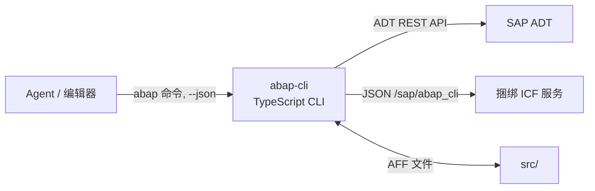

# abap-cli

> **Vibe coding for ABAP.** 开发 ABAP 像写本地文件一样：从编辑器改代码，用 CLI 同步进 SAP，由 AI agent 编排整个闭环。

<p align="center">
  <a href="https://github.com/chunrichi/abap-cli/actions/workflows/verify.yml"></a>
  <a href="LICENSE"></a>
  <a href="https://nodejs.org"></a>
</p>

`abap-cli` 把 SAP 的 ADT REST API，连同 ADT 覆盖不到的那部分能力所需的捆绑 ABAP 服务，收敛成一条命令链：pull → 编辑 → check → push → run → 验证。每条命令都支持 `--json` 并提供 `--schema` 契约，npm 包还自带 skills 与 agent 定义，所以 AI agent 可以完全脱离 GUI 端到端驱动 SAP。

📖 **English version**: [README.md](README.md)

---

## 为什么选 abap-cli

改一行 ABAP 通常意味着：登录 SAP GUI、打开 SE80、找 transport、锁对象、改代码、激活、解锁。一个循环 5 分钟起步，任何一步失败都要重来。

`abap-cli` 把它压缩成两条命令：

```bash
abap pull ZCL_MY_CLASS                                  # 类 + 源码 part → src/
# 用你喜欢的编辑器改 src/zcl_my_class.clas.abap
abap push src/zcl_my_class.clas.abap --tr DEVK900001    # 锁 → 写 → 激活 → 解锁
```

因为每条命令都说 `--json`，agent 可以不间断地跑同一个循环——`pull` → 编辑 → `check syntax` → `push` → `run` → 验证——并靠稳定的错误码而不是自然语言去恢复。

### 替代 GUI 里的往返操作

| 任务 | 以前 | 现在 |
|---|---|---|
| 用本地编辑器改代码 | SE80 | `abap pull` / `abap push` / `abap diff` |
| 不激活先做语法检查 | SE80 + 激活 | `abap check syntax` |
| 查表数据 | SE16N / SE16H | `abap select` |
| 查表字段 | SE11 | `abap fields` |
| 建类、程序、DDIC 对象、SICF 节点 | SE80 / SE11 / SICF | `abap create` |
| 管理传输请求 | SE01 / SE09 / SE10 | `abap transport` |
| 跑类或报表 | SE24 / SE38 + 调试器 | `abap run` / `abap run-report` |
| 看运行时 dump | ST22 | `abap dumps` |
| 解析事务码 | SE93 | `abap tcode` |
| 重构前查引用 | where-used 列表 | `abap where-used` |

### 不只是 ADT 的薄封装

如果你打算自己写脚本调 ADT REST API，`abap-cli` 已经替你补齐了这些部分：transport 自动解析、lock → write → activate 生命周期、abap-file-format 本地布局与 schema 校验、统一的 JSON / 退出码契约，以及一个承载 DDIC、表数据、报表、MIME、textpool 读取等标准 ADT API 不提供的端点的捆绑 ABAP 服务。底层 ADT 能力与 [`abap-adt-api`](https://www.npmjs.com/package/abap-adt-api) Node SDK 同源。

---

## 能做什么

- **就地在本地编辑**——`pull` 把对象拉成 abap-file-format 文件树，用编辑器改，`push` 写回（锁 → 写 → 激活 → 解锁）；写之前可以先 `check` 和 `diff`。
- **覆盖 21 种对象类型**——类、接口、程序、函数组；DDIC 表、结构、域、数据元素、锁对象、编号范围对象；SICF 节点、事务码；表类型、消息类、CDS 视图及 CDS / RAP 配套对象。其中 19 种支持 create / pull / push，`BDEF` 支持 pull / push，`SRVB` 仅元数据拉取。
- **只读探查 SAP**——`search`、`inspect`、`where-used`、`tcode`、`list`、`dumps`、`fields`、`select`、`run-report` 都不改系统。
- **运行与验证**——`abap run` 执行类（classrun）或 PUBLIC STATIC 方法；`abap run-report` 返回列表输出；`abap select` 就是 SE16N 的等价物。
- **管理传输**——`transport list / create / show / resolve / assign`，`push` 时按对象自动解析。
- **交给 agent**——所有命令都有 `--json` 与 `--schema`，退出码按类别稳定，npm 包自带 skills 与 agent 上下文，用 `abap init --agent` 一键安装。

---

## 安装

要求：**已修复安全漏洞的 Node.js** —— 22.23.4+，或更新版本线的 24.22.1+ / 26.12.1+（见 [SECURITY.md](SECURITY.md)）；启用 **ADT 服务**的 SAP 系统；具备开发权限的用户（创建 / 修改 / 激活仓库对象）。

```bash
npm install -g abap-cli
abap --version
```

从源码构建：

```bash
git clone https://github.com/chunrichi/abap-cli.git
cd abap-cli
npm install
npm run build
node dist/index.js --help
```

---

## 快速开始

```bash
# 1. 保存连接 profile（密码写入 OS keychain，不落项目文件）
abap profile add DEV --url https://sap.example.com:44300 --client 100 --username DEVELOPER --password '***'

# 2. 把当前工作区绑定到该 profile
abap init --profile DEV --yes
abap doctor                       # 环境 + 配置诊断

# 3. 拉取、编辑、推送
abap pull ZCL_MY_CLASS
# 编辑 src/zcl_my_class.clas.abap
abap push src/zcl_my_class.clas.abap --tr DEVK900001

# 4. 没有打开的 transport？现建一个
abap transport create "Feature work" --yes --json
```

在终端里裸跑 `abap init` 会进入交互向导。

### 启用 DDIC、数据与运行时端点

源对象的 pull / push / check 只依赖 ADT。DDIC CRUD、SICF 节点与事务码操作、`select`、`fields`、`run-report`、`tcode`、`mime`、`run --method` 以及 `pull --remote` 走捆绑在 `/sap/abap_cli` 下的 ICF 服务。每个系统装一次即可：

```bash
abap deploy --yes      # 3 个全局类装进 $TMP —— 无需 transport
abap deploy status     # 确认 SAP 侧版本与当前 CLI 一致
```

如果要装进自己的包并走传输，加 `--package <pkg> --tr <request>`。

### 给 AI agent 装上下文

```bash
abap init --agent claude    # copilot | claude | cursor | generic
```

把 6 个 skill 与 `abap-developer` agent 定义拷到对应 vendor 目录（`.github/`、`.claude/`、`.cursor/`、`.agents/`），需要时还会写 `CLAUDE.md` 或 `.cursor/rules/abap.mdc` 覆盖文件。目录结构与路由表见 [skills/README.md](skills/README.md)。

---

## 工作原理

三层：TypeScript CLI、捆绑的 ABAP 服务、agent markdown。完整说明见 [docs/architecture.md](docs/architecture.md)。



- **ADT 通道**——源对象（CLAS / INTF / PROG / FUGR / CDS / RAP）走标准 ADT REST API：搜索、源码读写、加锁、语法检查、激活、传输、where-used。
- **ICF 通道**——DDIC 对象、SICF 节点与事务码、表数据、报表、MIME、远程版本拉取、无 ADT text-elements 端点时的 textpool 读取，以及运行时 wrapper 走捆绑 ABAP 服务，由 `abap deploy` 安装。端点包括 `/ddic/*`、`/http/*`、`/tran/*`、`/tcode/*`、`/data/*`、`/run/*`、`/mime/*`、`/textpool/*`、`/version-source*` 与 `/_class-check*`。

发布形态只装 **3 个全局类**（handler + setup + 运行时 wrapper）；`abap deploy --dev` 装完整的 19 类开发形态供维护者使用。ICF 节点由 setup 类幂等创建，所以 `abap deploy` 可以安全重跑。

---

## 本地文件

本地产物遵循 SAP 的 **abap-file-format（AFF）** 扁平布局：每个产物直接平铺在 `src/` 下，文件名形如 `<name>.<type>[.<sub_type>][.<content_type>][.<language>].<ext>`。

```text
src/zcl_my_class.clas.json                # 元数据
src/zcl_my_class.clas.abap                # 主源码
src/zcl_my_class.clas.testclasses.abap    # include part
src/ztabl_demo.tabl.json                  # DDIC 表：元数据 + 定义 + settings
src/ztabl_demo.tabl.ddic
src/ztabl_demo.tabl.settings.json
src/(ui2)cl_json.clas.abap                # 命名空间对象 /UI2/CL_JSON
```

没有类型 / 对象子目录；命名空间对象用 AFF 括号 token（`/UI2/CL_JSON` → `(ui2)cl_json`）。`abap validate:aff <file-or-dir>` 按官方 schema 校验任意 AFF JSON。

---

## 命令速查

| 命令 | 干什么 |
|---|---|
| `abap init` | 把工作区绑定到 profile（写 `.abap.json`），设置默认 transport / 包 / 源目录，自省（`--show-config`）或清空字段，脚手架 agent 上下文（`--agent copilot / claude / cursor / generic`） |
| `abap profile` | 管理全局连接 profile：`list` / `show` / `add` / `set` / `test` / `delete` / `export` / `import` |
| `abap doctor` | 诊断环境与配置（只读且不连 SAP——连通性用 `abap profile test`）；`--fix` 应用安全修复 |
| `abap session` | 查看当前 profile 的会话 cookie jar（`session info`） |
| `abap deploy` | 部署捆绑 ICF 服务（`status` 探测 SAP 侧已装版本；`--dev` 安装开发形态） |
| `abap transport` | `list`（`--open`）/ `create` / `show` / `resolve` / `assign` 传输请求 |
| `abap pull <object>` | 把对象、包或整个 transport 拉成本地 AFF 文件（`--type`、`--package`、`--tr`、`--remote`、`--textpool`、`--active`、`--dir`、`--overwrite`、`--include-tests`） |
| `abap push <files...>` | 把本地改动写回 SAP：锁 → 写 → 激活 → 解锁（`--tr`、`--all`、`--atomic`、`--check-only`、`--dry-run`、`--no-activate`、`--fail-fast`） |
| `abap check` | `syntax`（走 SAP）/ `content`（纯本地）/ `atc`（`--variant`、`--out`），三者都支持 `--all`、`--changed`、`--strict` |
| `abap create <type> <name>` | 在 SAP 创建并激活对象（`--package`、`--description`、`--tr`、`--file`、`--template`、`--check-only`、`--audit`）；`--func <name>` 在已有函数组里加函数模块 |
| `abap create local <type> <name>` | 离线生成 AFF 草稿骨架，仅支持 CLAS / INTF / PROG / FUGR，不连 SAP |
| `abap activate <object>` | 激活对象的所有 inactive items（修复陈旧未激活） |
| `abap delete <object>` | 删除对象：锁 → 删除 → 解锁（`--type`、`--tr`、`--yes`） |
| `abap mime` | `create` / `delete`（`--recursive`）/ `push` MIME 仓库目录与文件 |
| `abap validate:aff` | 按官方 vendored schema 本地校验 AFF JSON 文件（`--wire <wire-dir>`） |
| `abap search <query>` | 按名称模式搜索对象（`--type`、`--package`、`--exact`、`--fuzzy`、`--page-all`） |
| `abap inspect <object>` | 只读对象元数据：`--structure`、`--includes`、`--locks`、`--package`、`--activation` |
| `abap where-used <object>` | 查对象直接引用，用于改动影响面评估（`--type`、`--ref-type`、`--package`、`--limit`） |
| `abap tcode <code>` | 事务码 → 入口程序与屏幕（TSTC → TSTCT） |
| `abap list` | 按包列对象（`--package` 必填；`--type`、`--limit`） |
| `abap dumps` | 列最近的 ST22 运行时 dump（`--limit`、`--user`） |
| `abap diff [file]` | 本地 ↔ SAP 只读对比（`--all`、`--remote`、`--local-only`） |
| `abap status` | 看哪些对象与 SAP 有差异（`--remote-only`、`--local-only`、`--since`、`--all`） |
| `abap run <class>` | 通过 classrun 或 PUBLIC STATIC 方法执行类（`--method`、`--args`、`--timeout`、`--dry-run`） |
| `abap run-report <report>` | 执行已激活报表并返回列表输出（`--variant`、`--param NAME=VALUE`、`--format raw / tsv / csv`） |
| `abap test <object>` | 跑 ABAP Unit 单测，返回摘要与失败用例（`--type`、`--risk`、`--duration`、`--all`、`--strict`） |
| `abap select --table <name>` | 只读查表，SE16N 等价物（`--fields`、`--where`、`--limit`、`--offset`、`--order-by`、`--group-by`、`--count-only`） |
| `abap fields <table>` | 从 DD03L 列表 / 视图字段，`--find` 反查（`--with-text`、`--as4local`、`--limit`） |
| `abap types` | 打印 CLI 类型 ↔ TADIR / DDIC 映射，纯本地（`<type>`、`--tadir-object`） |
| `abap report-stuck` | 在本地记录 agent 卡死报告用于 triage（`--goal`、`--tried`、`--where`） |

所有命令支持 `--json`（紧凑）和 `--pretty-json`（缩进）。每个顶层命令还支持 `--schema --json`，在不连 SAP 的情况下返回参数、选项、允许值、示例与错误码；嵌套子命令（如 `create local`、`transport list`、`deploy status`）只提供 `--help`。

---

## 支持的对象类型

21 个类型码，按 ADT 或捆绑 ICF 服务路由：

| 类型 | create | pull | push | 说明 |
|---|---|---|---|---|
| `CLAS` `INTF` `PROG` `FUGR` | ✅ | ✅ | ✅ | ABAP 源对象；可用 `create local` 离线草稿 |
| `TABL` `STRU` `DOMA` `DTEL` | ✅ | ✅ | ✅ | DDIC 走 ICF；TABL / STRU 为三件套 AFF |
| `ENQU` `NROB` | ✅ | ✅ | ✅ | 锁对象 / 编号范围对象，`create --file` |
| `HTTP` `TRAN` | ✅ | ✅ | ✅ | SICF 服务节点 / 事务码（SE93），`create --file` |
| `TTYP` `MSAG` `DDLS` | ✅ | ✅ | ✅ | `create --file`；TTYP / MSAG 在旧版 ECC 自动兜底 ICF，DDLS 仅 ADT |
| `SRVD` `DCLS` `DDLX` `DDLA` | ✅ | ✅ | ✅ | CDS / RAP 配套对象，`create --file`，仅 ADT |
| `BDEF` | — | ✅ | ✅ | RAP behavior definition 不能新建（ADT 无 create 端点），仅 pull / push |
| `SRVB` | — | ✅ | — | Service binding 仅元数据（在 SAP GUI 管理） |

DDIC、HTTP、TRAN、TTYP、MSAG 及 CDS / RAP 类型执行 `create` 时必须提供 `--file <aff.json>`；`abap create --schema <type>` 会给出该类型的契约，TABL / STRU / DOMA / DTEL 还附带示例 JSON。完整的类型 × 命令矩阵见 [wiki/object-types.md](wiki/object-types.md)。

---

## 为 agent 设计

### `--json` 契约

```jsonc
// 成功 — 写 stdout，exit 0
{ "status": "success", "meta": { "command": "abap pull", "version": "1.0.0", "timestamp": "...", "durationMs": 42, "warnings": [] }, "data": { /* ... */ } }

// 失败 — 写 stderr，非零退出码，stdout 保持为空
{ "status": "error", "meta": { /* ... */ }, "error": { "code": "NO_TRANSPORT", "category": "VALIDATION_ERROR", "message": "..." } }
```

退出码稳定且与 `error.category` 一一对应：`0` 成功、`1` 未知、`2` 用法、`3` 配置、`4` TLS、`5` 认证、`6` SAP、`7` 校验、`8` 未找到、`9` 锁定。警告只进 `meta.warnings`，不改变退出码。另有保留区退出码：`64` 本版本不支持 DDLS、`65` 通道探测。

### 命令自描述

```bash
abap select --schema --json    # 参数、选项、允许值、示例、错误码
```

agent 可以直接从二进制里发现整个命令面——不用查文档，也不用在 prompt 里猜。`--schema` 同时是[命令参考](docs/commands.md)的唯一生成来源。

### 随包分发的 skills 与 agent

npm 包内含 6 个 skill 和 1 个 agent 定义：

- **`abap-cli`**——路由 meta skill，把意图分发给领域 skill
- **`abap-cli-setup`** / **`abap-cli-search`** / **`abap-cli-edit`** / **`abap-cli-data`**——连接、元数据、写路径、数据与运行时
- **`abap-cli-performance`**——ABAP 性能 review 方法论
- **`abap-developer`**——编排上述 skill 的端到端 agent

上下文按需渐进加载（先 name + description，命中后再读正文），agent 只为用到的上下文付费。用 `abap init --agent` 安装；详见 [skills/README.md](skills/README.md) 与 [docs/agent-integration.md](docs/agent-integration.md)。

---

## 安全与凭证

- **只支持 basic 认证。** SAP 密码住在 OS keychain——原生 `security` / `cmdkey.exe` / `secret-tool` 后端，`keytar` 作为兜底——按 profile 名索引。它不会出现在 `.abap.json`、`.env` 或日志里；只有显式 `abap profile export --with-passwords` 会输出它。
- **仅元数据类命令惰性解析凭证**（`--help`、`types`、`init --show-config`）；密码路径（`profile add / set / show / delete / export`、`init --test-*`）会访问 keychain。
- **TLS 信任**按 profile 管理：`--ca` 导入 PEM CA；`--insecure` 仅供开发期跳过校验。
- `.abap.json` 与 `.env` 均在 `.gitignore` 中。`abap profile export` 只有在加 `--with-passwords` 时才导出密码，该输出需按密钥对待。

漏洞报告流程见 [SECURITY.md](SECURITY.md)。

---

## 已知限制

- 仅 basic 认证：不支持 X.509 客户端证书、浏览器 SSO、OAuth password grant 与 Kerberos。
- DDIC、表数据 / 报表类命令以及 `run --method` 需要先 `abap deploy` 一次；较旧的 ECC 版本 ADT 端点更少（CDS 会以 `DDLS_NOT_SUPPORTED_ON_ECC` 拒绝）。
- 当 ADT 没有非交互式 text-elements 写端点时，textpool 写入不可用（`TEXTPOOL_WRITE_UNSUPPORTED`）。
- 目前不支持：增强（ENHO）、SAPscript / Smart Forms、Web Dynpro、BAdI、IDoc / workflow。诚实的覆盖快照见 [wiki/coverage-matrix.md](wiki/coverage-matrix.md)。

---

## 文档

- [docs/getting-started.md](docs/getting-started.md)——安装、首次配置、端到端流程
- [docs/configuration.md](docs/configuration.md)——profile、`.abap.json`、凭证、环境变量
- [docs/commands.md](docs/commands.md)——生成的命令与参数参考
- [docs/agent-integration.md](docs/agent-integration.md)——`--json` 信封、错误码、agent 循环
- [docs/architecture.md](docs/architecture.md)——三层架构与捆绑 ICF 服务
- [docs/development.md](docs/development.md)——构建、测试、发布、新增命令
- [wiki/index.md](wiki/index.md)——知识库：对象类型、覆盖率矩阵、设计决策
- [CHANGELOG.md](CHANGELOG.md)——版本历史与迁移说明

## 贡献

一个 PR 一个交付单元，Conventional Commits，合并前 `npm run verify` 全绿——详见 [CONTRIBUTING.md](CONTRIBUTING.md)。问题与讨论走 [GitHub Issues](https://github.com/chunrichi/abap-cli/issues)：agent 可用 GitHub MCP 的建 issue 工具或 `gh issue create` 直接提交，没有 GitHub 访问能力时把预填 issue URL 交给用户。

## License

MIT——见 [LICENSE](LICENSE)。
