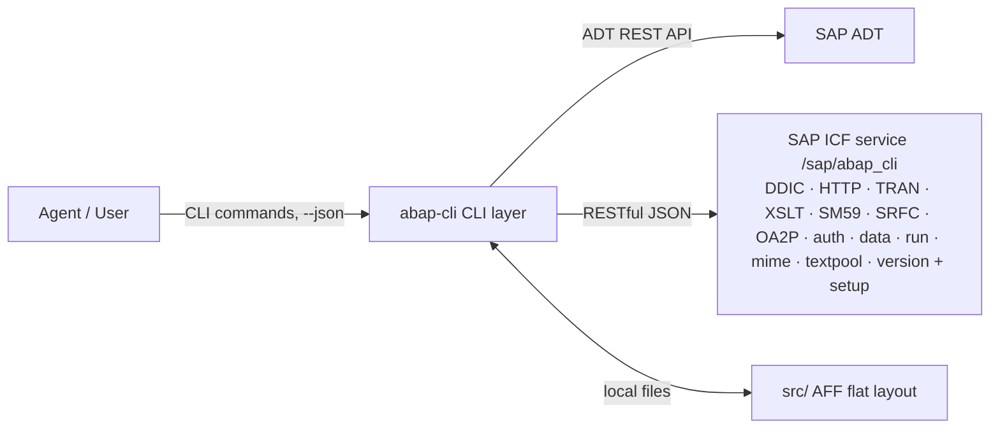

# Architecture

abap-cli follows a three-layer design with clear separation of responsibilities.

## The Three Layers

| Layer | Directory | Language | Responsibility |
|-------|-----------|----------|----------------|
| **CLI** | `src/abap_cli/` | TypeScript | Thin client: HTTP calls to SAP, file I/O, result display |
| **SAP** | `abap/` | ABAP | Bundled ICF service under `/sap/abap_cli`: DDIC + HTTP + TRAN + XSLT + SM59 + SRFC + OA2P + authorization-object CRUD, table data query, report runner, MIME repository, textpool read, version source, setup |
| **Agent** | `skills/` + `agents/` | Markdown | Skill prompts and multi-step workflow orchestration |



## CLI Layer (`src/abap_cli/`)

```
src/abap_cli/
├── index.ts              # commander entry point: global options + lifecycle hooks (lazy command registration)
├── top-error.ts          # top-level commander error routing (--json safe)
├── registry/             # commands.ts (single command list) + lazy.ts (lazy command stubs)
├── commands/             # one file per CLI command — thin: commander declaration + SCHEMA + print
├── flows/                # workflow orchestration, grouped by area
│   ├── edit/             # create / pull / push / deploy / activate coordinators + per-type modules
│   ├── setup/            # init, profile, doctor, command schemas, type catalog
│   ├── search/ data/ mime/   # search, SE16N-style data, MIME repository
│   └── core/             # cross-flow helpers: ATC, check, transport ops, stuck reports, system-side connection identity (whoami)
├── formats/              # abap-file-format: file resolver + pull strategies + shared AFF artifact contract
│   ├── ddic/             # DDIC wire / io / validate / examples (split from the former 880-line json.ts)
│   ├── docu/             # DOMA/DTEL long-text companion: docu-v1.json read/write/validate
│   ├── devc/             # DEVC (package) wire → AFF devc-v1.json mapping + create request body
│   ├── sm59/             # SM59 HTTP destination (RFCTYPE='G'): local-extension sm59-v1 ↔ ICF /sm59 wire mapping
│   ├── aff/              # generic AFF bundle: local naming / discovery / schema gate + ADT-blueSource transport for the writable AFF objects
│   ├── srfc/             # UCON RFC service: local-extension srfc-v1 ↔ ICF /srfc wire mapping
│   ├── oa2p/             # OAuth 2.0 client profile: local-extension oa2p-v1 ↔ ICF /oa2p wire mapping
│   └── auth/             # authorization-object family (AUTH / SUSC / SUCU / SUSH / SUSO): AuthTypeSpec + one spec module per type
│   └── auth/             # authorization-object family (AUTH / SUSC / SUCU / SUSH / SUSO): AuthTypeSpec + one spec module per type
│   └── auth/             # authorization-object family (AUTH / SUSC / SUCU / SUSH / SUSO): AuthTypeSpec + one spec module per type
│   └── auth/             # authorization-object family (AUTH / SUSC / SUCU / SUSH / SUSO): AuthTypeSpec + one spec module per type
│   └── auth/             # authorization-object family (AUTH / SUSC / SUCU / SUSH / SUSO): AuthTypeSpec + one spec module per type
│   └── xslt/             # XSLT pair (.xslt.json metadata + .xslt.xml source) mapping + line-ending normalisation
├── types/                # TYPE_REGISTRY — object-type metadata single source of truth
├── clients/              # AdtClientWrapper (abap-adt-api + cookie-aware HTTP transport), ADT blueSource AFF resources (adt-blue-source), ICF client + version check, connection probe, basic auth
├── config/               # .abap.json + user system profiles, keychain (secrets.ts), CA, profile export/import
├── session/              # session store (env/home/workspace) + cookie policy + lifecycle state machine
├── core/                 # cross-layer utilities: object/transport resolution, limits, path output, confirmation
├── aff/                  # vendored AFF schema resolution + validation
├── adc/                  # ADT Deployment Channel runtime probe + ICF register strategies
├── schema/               # vendored abap-file-format JSON schemas (copied into dist at build time)
└── output/               # unified JSON envelope (CliError/printResult/printError), error/exit codes, meta
```

### Key decisions

- **Session reuse is store-first, not write-first** — a CLI process may keep its SAP session open only when the encrypted jar landed in a *durable* store (`ABAP_CLI_SESSION_DIR` → `~/.abap-cli/sessions` → `<workspace>/.abap-cli/sessions`), contains a stateful `SAP_SESSIONID_*` cookie *and* its `sap-contextid`, and replay has not been paused after repeated auth failures. Everything else is logged out at command end. `$TMPDIR` is not a store: it cannot prove the next process can read the jar. The cookie policy matters because S/4HANA silently routes a request that carries the session cookie without its context cookie into a new SAP session (one orphan per command in SM04); see `docs/architecture.md`, `wiki/commands/session.md` and `wiki/design-decisions/015-session-lifecycle.md`.
- **ADT via `abap-adt-api`** — source objects (Class/Interface/Program/Function Group) use the standard ADT REST API: search, object structure, source GET/PUT, lock/unlock, content-based syntax check, ABAP Unit runs (`test`), activation, object creation, transport management, usage references (`where-used`).
- **Thin client** — the CLI only orchestrates HTTP calls and file/result handling; business logic stays on the SAP side.
- **Unified output** — every command uses `output/json.ts` (`printResult`/`printError`) so `--json` output is consistent across commands and parseable by agents. `OutputMode` is `'human' | 'json' | 'pretty-json'`; `--json` is compact (token-efficient), `--pretty-json` is indented. `stripEmpty()` recursively trims empty `{}` / `[]` from `data` in JSON modes.
- **Workflow orchestration** lives in `flows/edit/`: one coordinator per command plus per-type modules. `create.ts` (dispatcher) with `create-{ddic,http,tran,xslt,ttyp,msag,ddls,sm59}.ts` and the shared `ucon-object-flows.ts` (`SRFC` / `OA2P`), `create-local.ts`, `create-fugr-func.ts`; `pull.ts` with `pull-{source,ddic,http,transport,xslt,textpool,remote,package,tr,ttyp,msag,ddls,srvd,bdef,cds-extension,sm59}.ts` plus `ucon-object-flows.ts`; `push.ts` with `push-object.ts`, `push-fugr.ts`, `push-textpool.ts`, `push-{xslt,ttyp,msag,ddls,sm59}.ts` (with the shared per-type ADT content helpers `ttyp-adt.ts` / `msag-adt.ts`); `delete-sm59.ts` and `sm59-shared.ts` own the SM59 lifecycle rules (RFCDEST name validation, no package / transport); the authorization-object family has one type-agnostic flow set (`{create,pull,push,delete}-auth.ts` + `auth-shared.ts`) driven by `formats/auth/<type>.ts` specs; the authorization-object family has one type-agnostic flow set (`{create,pull,push,delete}-auth.ts` + `auth-shared.ts`) driven by `formats/auth/<type>.ts` specs; the authorization-object family has one type-agnostic flow set (`{create,pull,push,delete}-auth.ts` + `auth-shared.ts`) driven by `formats/auth/<type>.ts` specs; the authorization-object family has one type-agnostic flow set (`{create,pull,push,delete}-auth.ts` + `auth-shared.ts`) driven by `formats/auth/<type>.ts` specs; `ucon-object-flows.ts` + `ucon-shared.ts` own the `SRFC` / `OA2P` create / pull / push / delete flows shared by both UCON object types (name validation, AFF document loading, package / transport resolution); AFF objects use `{create,pull,push,delete}-aff.ts` + `aff-shared.ts` (ADT blueSource for the writable four, ICF `/aff` GET for the `ENHO` / `ENHS` pull); `activate.ts` (inactive-item activation); `deploy-flow.ts` (deploy + status) with `deploy.ts` (bundled-source assembly) and `deploy-merge.ts` (release-form merger); plus `run-flow.ts` (classrun / wrapper static method), `select-flow.ts` (SE16N equivalent), `tcode-flow.ts` (TSTC → TSTCT), `where-used-ops.ts`, `search-flow.ts` (ADT quickSearch paging/filters), `status.ts`, `diff.ts`, `inspect-ops.ts`, `doctor-checks.ts`, `atc.ts`, `core/check.ts` (syntax / content / ATC validation), `core/unit-test.ts` (ABAP Unit run: level validation, flags, summary + failures projection), `core/whoami.ts` (system-side connection identity via the ICF `/whoami` endpoint). Shared resolution lives in `core/`: `core/resolve.ts` (object URL + parts resolution, packageName from the search hit), `core/transport.ts` (`resolveTransport`: `--tr` > config > user's open request > error; `isLocalPackageName` / `transportForPackage` for `$`-prefixed local packages). `push.ts` resolves the transport **per object** (`transportInfo` binding first, local packages free). Commands stay thin: they parse arguments and print the `{ data, human }` result the flow returns.
- **AFF JSON artifacts share one contract** — `formats/artifact.ts` defines `JsonArtifact<TLocal>` (read / write / validate / load) and `WireArtifact<TLocal, TWire>` (+ `toWire` / `fromWire`), with optional `beforeWrite` (pre-write schema gate) and `validate` overrides.
  The eleven JSON format modules (TTYP / MSAG / DDLS / ENQU / NROB / HTTP / TRAN / XSLT / SM59 / SRFC / OA2P) declare their artifact with `defineJsonArtifact` / `defineWireArtifact` instead of repeating the same file+schema plumbing; HTTP/TRAN use `beforeWrite` to keep their validate-before-write contract (CLI envelope stripped first). SM59 / SRFC / OA2P are local-extension documents (upstream AFF has none of those formats), so their artifacts validate against the matching `*-v1.json` and strip the server-owned identity / admin fields on pull.
  DDLS keeps a bespoke asymmetric wire mapping (the source lives in the sibling `.acds`); XSLT likewise pairs with a sibling `.xslt.xml` source and normalises line endings through one `normalizeXsltSource()` implementation; DDIC is the remaining format module with custom sidecar I/O. The routing table's `aff-json` validator consumes the same artifacts.
- **AFF objects are schema-driven, not format-mapped** — `APLO` / `CHDO` / `EVTB` / `SMBC` / `ENHO` / `ENHS` vendor the official upstream AFF v1 schemas (`aplo-v1.json` … `enhs-v1.json`) exactly like the other AFF types, and are discovered / validated through the same `aff/router.ts` suffix table + `schemaPathFor()` (`abap validate:aff` covers their `<token>.<type>.json` files). Unlike the per-type format modules above, there is no local↔wire translation: the AFF JSON document *is* the object payload, so these six types need no field projection. Their channels are split by capability: `APLO` / `CHDO` / `EVTB` / `SMBC` read and write the official AFF JSON through an ADT blueSource resource (`source/main`; lock / save-activates / transport), while `ENHO` / `ENHS` are pull-only through the read-only ICF `GET /aff/<TYPE>/<NAME>` route because SAP's AFF handler for these two types has no working write or delete implementation (`flows/edit/*-aff.ts`, `formats/aff/bundle.ts`).
- **DOMA/DTEL long text is a 0..1 AFF companion, not an object type** — `formats/docu/json.ts` owns the `docu-v1.json` document (`formatVersion` + `lines[]`), the `<name>.<type>.docu.json` filename rule and the wire normalization; `flows/edit/docu-companion.ts` owns the pull/push decisions (best-effort pull, validate-before-main-write push, `lines: []` = delete). `DOCU` is a schema/companion identifier only: no `types/registry.ts` row, no `abap create` path, no `abap types` entry — it is reached solely as a companion of DOMA/DTEL. `aff/router.ts` routes the two companion suffixes to it so `abap validate:aff` validates them, and `aff/companion-check.ts` does not require them (0..1).
- **DEVC (package) is one ADT resource, not an AFF artifact** — `formats/devc/json.ts#wireToLocal` maps the `pak:package` XML (`GET /sap/bc/adt/packages/<name>`) onto `devc-v1.json`; `buildCreateWire` assembles the `POST /sap/bc/adt/packages` body. The package has no include / source / activation, so create and pull are dedicated handlers (`flows/edit/{create,pull}-devc.ts`) instead of the generic ADT source path, and delete is a lock-free `DELETE` with a one-shot fresh-session retry when a stale ADT session holds the enqueue lock (`delete-devc.ts`). ADT exposes no package update endpoint, so push is rejected via the registry's `pushUnsupportedReason` (`TYPE_NOT_SUPPORTED`).
- **Type pools are AFF metadata + classic ABAP source** — `TYPE` keeps the upstream AFF layout (`type-v1.json` header + `.type.abap` source) and writes through ADT `/ddic/typegroups` (`TYPE/DG`, five-character names). Metadata updates happen under the same lock as the source write so the AFF description survives a pull → edit → push round-trip. Table types (`TTYP`) are pure DDIC metadata and therefore carry no ABAP companion — the pseudo-DDL `.type.abap` sidecar was removed because `.type.abap` is the AFF type-pool filename.
- **CDS technical objects are ADT metadata + `.acds` source pairs** — `DTDC` / `DTEB` / `DSFD` / `DRTY` keep the CDS source in a sibling `.acds` file (same layout as DDLS) and write it through `source/main` under a lock, then activate; the AFF header description is synced through the metadata resource so a pull → edit → push round-trip keeps it. `DSFI` has no sidecar: its `source/main` *is* the AFF JSON document, so the local file and the wire body are the same shape. Endpoint/media-type/projection knowledge lives in `clients/cds-tech.ts`; the four flows live in `flows/edit/{create,pull,push,delete}-cds-tech.ts`. Two SAP-side gates are surfaced, not worked around: DTEB needs a bufferable view entity, and DSFD writes need the `DD_CDS_DSFD` user parameter (mapped to `DSFD_FEATURE_NOT_ENABLED` with SU3 instructions).
- **Application jobs are one AFF JSON document over a blueSource resource** — `SAJC` (catalog entry) and `SAJT` (template) keep the official AFF v1 document locally (`<name>.sajc.json` / `<name>.sajt.json`) and write it to the ADT `/sap/bc/adt/applicationjob/{catalogs,templates}` `source/main` under a lock, then activate. The JSON document model is release-dependent: the reference SAP_BASIS 757 serves the flat `className`/`reportName` model, while current AFF v1 uses `generalInformation`/`exitClasses`. The CLI probes the `$schema` sub-resource and translates; fields the target model cannot carry are rejected by name instead of silently dropped. The header description is synced through the metadata resource in the same lock, and referenced objects (executed class, catalog entry) are validated by SAP at save time — its generic rejection is mapped to an actionable error in `clients/appjob.ts`.
- **ATC configuration objects are ADT XML resources over AFF JSON** — `CHKC` / `CHKO` / `CHKV` are AFF-native, pure-JSON objects, but ADT exposes them as versioned XML envelopes (`chkcv1` / `chkov1` / `chkvv4`) rather than source or JSON documents. `clients/atc.ts` owns the URL / media-type / XML ↔ AFF projection; `flows/edit/{create,pull,push,delete}-atc.ts` own the lifecycle. Create and push write the resource and then activate it (the object is inactive otherwise); there is no ICF fallback because the underlying ATC persistence has no ICF channel. `abap-adt-api` has no endpoint for these types, so the requests are hand-written like `clients/srvb.ts`.
- **SM59 HTTP destinations are system-table entries, not repository objects** — `SM59` (only `RFCTYPE='G'`, HTTP connection to external server) is a client-independent `RFCDES` row: the definition is encoded in `RFCOPTIONS` and the short text lives in `RFCDOC`. There is no TADIR object and no CTS transport path, so the registry marks the type `packageNotApplicable` and `create` / `push` / `delete` reject an explicit `--package` / `--tr` instead of recording a fake transport. The local side is the local-extension `sm59-v1` document (`targetHost` / `port` / `protocol` / `pathPrefix` / `description`, description ≤ 72 chars). Create uses the maintenance-API defaults for options the v1 model does not carry; push loads and keeps the API-known attribute values but the API rebuilds `RFCOPTIONS` on save, so legacy option codes SAP shipped on old destinations are dropped — pull → push is lossless only for destinations this type created (documented as a limitation). The SAP handler uses `SRFC_DESTAPI` (`CL_DEST_FACTORY` / `CL_DEST_HTTP_EXT`) rather than writing `RFCOPTIONS` by hand and rejects non-G destinations with `SM59_TYPE_NOT_SUPPORTED`.
- **Authorization objects are local JSON documents over hand-written ICF routes** — `AUTH` / `SUSC` / `SUCU` / `SUSH` / `SUSO` have no ADT resource and no upstream AFF handler, so each type owns a spec module under `formats/auth/` (document shape, name / filename rules, wire mapping) and one route `/auth/<sub>/<name>` in the bundled service. The family flows (`flows/edit/{create,pull,push,delete}-auth.ts`) stay type-agnostic: `create` POSTs the document, `pull` GETs it and strips the read-side `name` / `package`, `push` probes then PUTs (update-only), `delete` DELETEs. The package and transport request travel as query parameters; `$`-prefixed packages are transport-free, everything else needs `--tr`. The SUSO SAP_ALL / SAP_NEW regeneration is an explicit opt-in (`--regenerate-profiles` → `regenerateProfiles=true`) and is skipped by default; SUCU authorization groups can only be deleted in local packages because the ICF session cannot record a CTS delete entry. `SUSH` reuses the upstream AFF `sush-v1` document; the other four are local schema extensions (`auth-v1` extends the upstream field format by the SU20 exit/activity fields).
- **Authorization objects are local JSON documents over hand-written ICF routes** — `AUTH` / `SUSC` / `SUCU` / `SUSH` / `SUSO` have no ADT resource and no upstream AFF handler, so each type owns a spec module under `formats/auth/` (document shape, name / filename rules, wire mapping) and one route `/auth/<sub>/<name>` in the bundled service. The family flows (`flows/edit/{create,pull,push,delete}-auth.ts`) stay type-agnostic: `create` POSTs the document, `pull` GETs it and strips the read-side `name` / `package`, `push` probes then PUTs (update-only), `delete` DELETEs. The package and transport request travel as query parameters; `$`-prefixed packages are transport-free, everything else needs `--tr`. The SUSO SAP_ALL / SAP_NEW regeneration is an explicit opt-in (`--regenerate-profiles` → `regenerateProfiles=true`) and is skipped by default; SUCU authorization groups can only be deleted in local packages because the ICF session cannot record a CTS delete entry. `SUSH` reuses the upstream AFF `sush-v1` document; the other four are local schema extensions (`auth-v1` extends the upstream field format by the SU20 exit/activity fields).
- **Authorization objects are local JSON documents over hand-written ICF routes** — `AUTH` / `SUSC` / `SUCU` / `SUSH` / `SUSO` have no ADT resource and no upstream AFF handler, so each type owns a spec module under `formats/auth/` (document shape, name / filename rules, wire mapping) and one route `/auth/<sub>/<name>` in the bundled service. The family flows (`flows/edit/{create,pull,push,delete}-auth.ts`) stay type-agnostic: `create` POSTs the document, `pull` GETs it and strips the read-side `name` / `package`, `push` probes then PUTs (update-only), `delete` DELETEs. The package and transport request travel as query parameters; `$`-prefixed packages are transport-free, everything else needs `--tr`. The SUSO SAP_ALL / SAP_NEW regeneration is an explicit opt-in (`--regenerate-profiles` → `regenerateProfiles=true`) and is skipped by default; SUCU authorization groups can only be deleted in local packages because the ICF session cannot record a CTS delete entry. `SUSH` reuses the upstream AFF `sush-v1` document; the other four are local schema extensions (`auth-v1` extends the upstream field format by the SU20 exit/activity fields).
- **Authorization objects are local JSON documents over hand-written ICF routes** — `AUTH` / `SUSC` / `SUCU` / `SUSH` / `SUSO` have no ADT resource and no upstream AFF handler, so each type owns a spec module under `formats/auth/` (document shape, name / filename rules, wire mapping) and one route `/auth/<sub>/<name>` in the bundled service. The family flows (`flows/edit/{create,pull,push,delete}-auth.ts`) stay type-agnostic: `create` POSTs the document, `pull` GETs it and strips the read-side `name` / `package`, `push` probes then PUTs (update-only), `delete` DELETEs. The package and transport request travel as query parameters; `$`-prefixed packages are transport-free, everything else needs `--tr`. The SUSO SAP_ALL / SAP_NEW regeneration is an explicit opt-in (`--regenerate-profiles` → `regenerateProfiles=true`) and is skipped by default; SUCU authorization groups can only be deleted in local packages because the ICF session cannot record a CTS delete entry. `SUSH` reuses the upstream AFF `sush-v1` document; the other four are local schema extensions (`auth-v1` extends the upstream field format by the SU20 exit/activity fields).
- **Authorization objects are local JSON documents over hand-written ICF routes** — `AUTH` / `SUSC` / `SUCU` / `SUSH` / `SUSO` have no ADT resource and no upstream AFF handler, so each type owns a spec module under `formats/auth/` (document shape, name / filename rules, wire mapping) and one route `/auth/<sub>/<name>` in the bundled service. The family flows (`flows/edit/{create,pull,push,delete}-auth.ts`) stay type-agnostic: `create` POSTs the document, `pull` GETs it and strips the read-side `name` / `package`, `push` probes then PUTs (update-only), `delete` DELETEs. The package and transport request travel as query parameters; `$`-prefixed packages are transport-free, everything else needs `--tr`. The SUSO SAP_ALL / SAP_NEW regeneration is an explicit opt-in (`--regenerate-profiles` → `regenerateProfiles=true`) and is skipped by default; SUCU authorization groups can only be deleted in local packages because the ICF session cannot record a CTS delete entry. `SUSH` reuses the upstream AFF `sush-v1` document; the other four are local schema extensions (`auth-v1` extends the upstream field format by the SU20 exit/activity fields).
- **UCON RFC services and OAuth 2.0 profiles are Workbench objects read/written through their persistence classes** — `SRFC` (`UCONRFCSERVHEAD` / `UCONRFCSERVTEXT`) and `OA2P` (`OA2C_PROFILES` / `OA2P_SCOPES`) are TADIR objects with no ADT resource and no upstream AFF format, so the bundled ICF service serves `/srfc/<name>` and `/oa2p/<name>` and the local side is a local-extension `srfc-v1` / `oa2p-v1` document. `SRFC` reads through the public UCON RFC service API (`CL_UCON_API_FACTORY=>GET_RFC_SERVICE`) and writes through `CL_UCONRFC_OBJECT_PERSIST` (the UCONCOCKPIT save path: function module / scope / default profile / short text, then a UCON runtime-cache refresh); delete goes through `CL_UCON_API_FACTORY=>DELETE_RFC_SERVICE` (rows + TADIR + CTS + change documents + runtime). `OA2P` uses `CL_OA2P_OBJECT_PERSIST` / `CL_OA2P_OBJECT_DATA` for all operations, `RS_CORR_INSERT` for TADIR / transport, and refuses to delete a profile that is still assigned to OAuth 2.0 clients. Both types support `--package` / `--tr` like the other ICF DDIC types (`$`-prefixed packages are transport-free); the flows are one shared implementation (`ucon-object-flows.ts`) bound per type in `routing.ts`.
- **Type routing is one explicit table** — `flows/edit/routing.ts` holds `TYPE_ROUTES`, one row per supported type, with the create / pull / push route and the channel each operation uses (`adt`, `icf`, or `auto` = channel detection picks ADT vs ICF per SAP release). `kind: 'source'` means the coordinator's generic ABAP-source path handles the operation; `kind: 'handler'` carries the per-type flow function. `types/registry.ts` stays the single source for object-type capability metadata (`createObjtype` / AFF schema / `requiresFile`); local file paths are not registered there — AFF artifacts are written flat as `<rootDir>/<name>.<type>.<ext>`. A consistency test (`test/unit/routing.test.ts`) fails when the two tables drift.
  - `create` / `pull` / `push` dispatchers do exactly one table lookup instead of if-chains. Artifact pushes are split by file kind: `icf-json` routes post through the ICF service (`push-icf.ts` for DDIC / HTTP / TRAN, `push-xslt.ts` for the XSLT pair), `aff-json` routes are AFF documents whose flow runs channel detection (TTYP / MSAG / DDLS / NROB), `source` routes use the generic ADT source push.
  - `create` fail-fast for `--file`-only types and the `create --schema` contract both read `ObjectTypeEntry.requiresFile` (`requiresFileFor` / `typesRequiringFile`).
  - `DEVC` is a handler route on ADT for create / pull; it intentionally has no push row, and `ObjectTypeEntry.pushUnsupportedReason` supplies the rejection text the push flow emits.

## SAP Layer (`abap/`)

The bundled ICF service under `/sap/abap_cli` is maintained in two forms generated from the same sources.

**Development tree** — `abap/src/` keeps the service as 30 normal global classes, in the same abap-file-format flat layout the CLI writes (one `<name>.clas.abap` holding definition + implementation, plus a canonical `<name>.clas.json` per class; there are no per-type or per-object directories):

- **`ZCL_ABAP_VIBE_ICF`** — HTTP handler (`IF_HTTP_EXTENSION`): a thin front controller that dispatches `/ddic/*`, `/http/*`, `/sm59/*`, `/srfc/*`, `/oa2p/*`, `/auth/*`, `/auth/*`, `/auth/*`, `/auth/*`, `/auth/*`, `/tcode/*`, `/tran/*`, `/xslt/*`, `/jobd/*`, `/textpool/*`, `/data/*`, `/run/*`, `/mime/*`, `/version-source*`, `/whoami*`, `/_class-check*` into the helper classes below. The root path returns a unified JSON envelope with service id + version; unknown paths / methods return unified error JSON.
- **`ZCL_ABAP_VIBE_ICF_TYPES`** — the shared types (~100 `ty_*` / `tt_*`) in its PUBLIC SECTION; every helper class references them as `zcl_abap_vibe_icf_types=>…`.
- **Six authorization-object helpers** — `ZCL_ABAP_VIBE_ICF_AUTH_COMMON` (shared request parsing, package/transport rule, TADIR / `RS_CORR_INSERT` recording, write envelope) plus one handler per type (`ZCL_ABAP_VIBE_ICF_{AUTH,SUSC,SUCU,SUSH,SUSO}`) serving `/auth/<sub>/<name>`.
- **Six authorization-object helpers** — `ZCL_ABAP_VIBE_ICF_AUTH_COMMON` (shared request parsing, package/transport rule, TADIR / `RS_CORR_INSERT` recording, write envelope) plus one handler per type (`ZCL_ABAP_VIBE_ICF_{AUTH,SUSC,SUCU,SUSH,SUSO}`) serving `/auth/<sub>/<name>`.
- **Six authorization-object helpers** — `ZCL_ABAP_VIBE_ICF_AUTH_COMMON` (shared request parsing, package/transport rule, TADIR / `RS_CORR_INSERT` recording, write envelope) plus one handler per type (`ZCL_ABAP_VIBE_ICF_{AUTH,SUSC,SUCU,SUSH,SUSO}`) serving `/auth/<sub>/<name>`.
- **Six authorization-object helpers** — `ZCL_ABAP_VIBE_ICF_AUTH_COMMON` (shared request parsing, package/transport rule, TADIR / `RS_CORR_INSERT` recording, write envelope) plus one handler per type (`ZCL_ABAP_VIBE_ICF_{AUTH,SUSC,SUCU,SUSH,SUSO}`) serving `/auth/<sub>/<name>`.
- **Six authorization-object helpers** — `ZCL_ABAP_VIBE_ICF_AUTH_COMMON` (shared request parsing, package/transport rule, TADIR / `RS_CORR_INSERT` recording, write envelope) plus one handler per type (`ZCL_ABAP_VIBE_ICF_{AUTH,SUSC,SUCU,SUSH,SUSO}`) serving `/auth/<sub>/<name>`.
- **Fifteen domain helpers** — `ZCL_ABAP_VIBE_ICF_{RESPONSE,MIME,HTTP,DDIC,TEXTPOOL,TCODE,XSLT,SM59,SRFC,OA2P,JOBD,DATA,FIELDS,VERSION,RUN}`: JSON envelope + error responses, MIME repository, HTTP service nodes, DDIC CRUD, textpool read, transaction code / transaction, XSLT transformation CRUD (`CL_O2_API_XSLTDESC`), SM59 HTTP destination CRUD (standard `SRFC_DESTAPI` maintenance API), UCON RFC service CRUD (UCON RFC API + Workbench persistence + runtime cache), OAuth 2.0 client profile CRUD (OA2P Workbench persistence + TADIR/CTS), application job definition CRUD (SM36 through `CL_JR_JOB_DEFINITION`; TADIR / CTS via `RS_CORR_INSERT`), table-data query, table field lookup, version source, report runner.
- **Five format renderers** — `ZCL_ABAP_VIBE_{TABL,TTYP,MSAG,ENQU,NROB}_FORMAT`: abap-file-format renderers for the ICF read paths of the dual-channel / DDIC types (`TABL` generates the three-piece canonical layout `tabl.json` + `tabl.ddic` + `tabl.settings.json`; `STRU` emits the two-piece variant).
- **Standalone classes (never merged)** — `ZCL_ABAP_VIBE_ICF_SETUP` (`IF_OO_ADT_CLASSRUN` runner that idempotently creates/binds/activates the SICF node via `CL_ICF_TREE`; ADR gap: SICF config is not covered by ADT REST) and `ZCL_ABAP_VIBE_RUNNER` (reflection-based wrapper for `abap run --method`: calls PUBLIC STATIC methods on arbitrary classes and serialises the `RETURNING` value).
- `ZCL_ABAP_VIBE_ICF_MIME` also carries a small definitions prelude (`TYPE-POOLS: skwf, wbmr.`) for the SAP type-pool types it uses.

**Manifest** — `abap/deploy.json` (next to `abap/src`, deliberately outside the AFF tree) is the single source of truth for roles: `handler`, `merged[]` (development global class → release `lcl_*` local name, in stable base order), `standalone[]`. A class in `abap/src` that the manifest does not list fails the deploy.

**Release form** — `abap deploy` (default) installs 3 global classes: the handler (main + generated definitions / implementations), `ZCL_ABAP_VIBE_ICF_SETUP` and `ZCL_ABAP_VIBE_RUNNER`. The 27 merged helpers are downgraded to `lcl_*` local classes and folded into the handler's two includes in dependency order; `zcl_*` references in the handler main are rewritten to the matching `lcl_*` names. The merge is a pure string module (`src/abap_cli/flows/edit/deploy-merge.ts`): manifest validation, class-header downgrade, word-boundary rename, stable dependency topological sort, deterministic output, and a leftover-global-name guard. The generated includes are never committed.

**Development form** — `abap deploy --dev` installs all 31 classes as global objects in dependency order (shared types first, format renderers before the DDIC helper, the handler after every helper, setup / runner last) and skips the merge. Maintainers use it to iterate on a single class on a real system, where each class can be syntax-checked, activated and run on its own. The two forms coexist on one system: the release form uses `lcl_*` locals, the development form uses `zcl_*` globals, and only the handler name is shared — whichever form was deployed last owns its three parts.

The ICF endpoint is **stateless** (`IF_HTTP_SERVER->SET_SESSION_STATEFUL( abap_false )` in the handler): every route does its work inside one request, and no SAP user session is kept between requests. Before this, each CLI command that used ICF left one session in SM04.

Endpoints exposed under `/sap/abap_cli/` (current service version `2.6.1`, see `src/abap_cli/clients/icf-version.ts`):

| Endpoint | Used by |
|---|---|
| `/` (root: service id + version) | `abap deploy status`, `abap init` (ICF check), `abap doctor` |
| `/ddic/<type>` (GET/POST) | `DOMA` / `DTEL` / `TABL` / `STRU` / `ENQU` / `NROB` (+ ICF fallback for `TTYP` / `MSAG`): `abap create` / `push` / `pull` |
| `/ddic/<type>/<name>/docu` (GET/POST) | `DOMA` / `DTEL` long text (`<name>.doma.docu.json` / `<name>.dtel.docu.json`): `abap pull` / `abap push` companion; GET answers `DOCU_NOT_FOUND` when the object has no text, POST with `lines: []` deletes it |
| `/ddic/view/<name>` (GET/POST/PUT/DELETE) | database view (SE11 view, local-extension `view-v1` document): `abap create` / `pull` / `push` / `delete` (delete is `$TMP`-only) |
| `/ddic/shlp/<name>` (GET/POST/PUT/DELETE) | search help (SE11 search help, local-extension `shlp-v1` document; elementary + collective): `abap create` / `pull` / `push` / `delete` (delete is `$TMP`-only) |
| `/aff/<TYPE>/<NAME>` (GET only) | `ENHO` / `ENHS` pull: SAP's AFF framework serializes the object into its official AFF file(s), written verbatim by `abap pull`. **Read-only route** — there is no create / update / delete path (the AFF handler's write and delete implementations are empty or assert). The writable AFF objects (`APLO` / `CHDO` / `EVTB` / `SMBC`) go through ADT blueSource instead |
| `/http/<name>` (GET/POST) | HTTP service node (SICF): `abap create HTTP` / `abap push <file>.http.json` / `abap pull --type HTTP` |
| `/tran/<code>` (GET + POST/PUT/DELETE) | transaction code (SE93): `abap pull` / `abap tcode` read path; `create` / `push` upsert through `RS_CORR_INSERT` + `RPY_TRANSACTION_INSERT`; `delete` removes `$TMP` transactions |
| `/xslt/<name>` (GET + POST/PUT/DELETE) | transformation program (XSLT): `abap pull --type XSLT` reads metadata + source; `create` / `push` upsert through `CL_O2_API_XSLTDESC` (an existing transformation is updated in place, keeping its version history); `delete` removes the transformation. Local side is the AFF pair `.xslt.json` + `.xslt.xml` |
| `/jobd/<name>` (GET + POST/PUT/DELETE) | application job definition (SM36): local-extension `jobd-v1` document; the handler serializes `CL_JR_JOB_DEFINITION` (STJR rows) and persists through `CREATE_JD` / `MODIFY_JD`, records TADIR/transport with `RS_CORR_INSERT` and clears the rows on delete |
| `/srfc/<name>` (GET + POST/DELETE) | UCON RFC service: `abap pull` / `create` / `push` / `delete`. Read through the public UCON RFC service API, write through the Workbench persistence class + `RS_CORR_INSERT` (function module / scope / default profile / short text), then a UCON runtime-cache refresh; delete through the UCON API factory. Local side is the local-extension `.srfc.json`; RFC services are TADIR objects, so package / transport apply |
| `/oa2p/<name>` (GET + POST/DELETE) | OAuth 2.0 client profile: `abap pull` / `create` / `push` / `delete` over the OA2P Workbench persistence classes + `RS_CORR_INSERT`. Local side is the local-extension `.oa2p.json` (provider type / scopes / no-authority-check flag); deletion is refused while the profile is assigned to OAuth 2.0 clients |
| `/sm59/<name>` (GET + POST/DELETE) | SM59 HTTP destination (`RFCTYPE='G'`): `abap pull` / `create` / `push` / `delete` through the standard `SRFC_DESTAPI` maintenance API (`CL_DEST_FACTORY` / `CL_DEST_HTTP_EXT` / `IF_DEST_ROOT~save`; delete via `CL_DEST_FACTORY=>delete`). Local side is the local-extension `.sm59.json`; destinations are client-independent system-table entries, so there is no package / transport envelope and non-G destinations are rejected with `SM59_TYPE_NOT_SUPPORTED`. There is no list endpoint and no activation step |
| `/auth/<sub>/<name>` (GET/POST/PUT/DELETE) | authorization-object family (`auth` / `susc` / `sucu` / `sush` / `suso`): `abap create` / `pull` / `push` / `delete` for `AUTH` / `SUSC` / `SUCU` / `SUSH` / `SUSO`; `SUSH` create is limited to `RF` applications, `SUSO` takes the `regenerateProfiles=true` opt-in, `SUCU` deletes only local packages |
| `/auth/<sub>/<name>` (GET/POST/PUT/DELETE) | authorization-object family (`auth` / `susc` / `sucu` / `sush` / `suso`): `abap create` / `pull` / `push` / `delete` for `AUTH` / `SUSC` / `SUCU` / `SUSH` / `SUSO`; `SUSH` create is limited to `RF` applications, `SUSO` takes the `regenerateProfiles=true` opt-in, `SUCU` deletes only local packages |
| `/auth/<sub>/<name>` (GET/POST/PUT/DELETE) | authorization-object family (`auth` / `susc` / `sucu` / `sush` / `suso`): `abap create` / `pull` / `push` / `delete` for `AUTH` / `SUSC` / `SUCU` / `SUSH` / `SUSO`; `SUSH` create is limited to `RF` applications, `SUSO` takes the `regenerateProfiles=true` opt-in, `SUCU` deletes only local packages |
| `/auth/<sub>/<name>` (GET/POST/PUT/DELETE) | authorization-object family (`auth` / `susc` / `sucu` / `sush` / `suso`): `abap create` / `pull` / `push` / `delete` for `AUTH` / `SUSC` / `SUCU` / `SUSH` / `SUSO`; `SUSH` create is limited to `RF` applications, `SUSO` takes the `regenerateProfiles=true` opt-in, `SUCU` deletes only local packages |
| `/tcode/<code>` (GET) | `abap tcode` (TSTC → TSTCT) |
| `/textpool/<category>` (GET read; POST stub) | `abap pull --textpool` read. The POST branch returns `TEXTPOOL_WRITE_UNSUPPORTED`: textpool write needs the ADT text-elements write endpoint and is unavailable on releases that only expose the non-interactive API (verified on A4H) |
| `/data/query`, `/data/find-tables-by-fields` (POST) | `abap select --table`, `abap fields --find` |
| `/run/report` (POST) | `abap run-report` (report list output) |
| `/mime/folder` (POST/PUT), `/mime/resources` (POST) | `abap mime create` / `delete` / `push` |
| `/version-source` (GET) | `abap pull --remote <system>` (TMS RFC destination) |
| `/whoami` (GET) | `abap whoami`: system-side identity of the authenticated session — user, SID, client, application server, database, OS, ABAP release (auth-method independent, so it keeps working when SSO lands) |
| `/_class-check` (GET) | diagnostic / activation probe (no CLI caller in this repo) |

Local packages (`$` prefixed) are transport-free for ADT-backed writes and for the bundled ICF handler: ENQU / NROB create, XSLT create and VIEW / SHLP / TRAN delete treat `$`-prefixed packages as local. ICF deployments older than this change recognise only `$TMP` — run `abap deploy` once after upgrading. `TEST`-prefixed packages are not transport-free.

DEVC does not use the ICF service: packages are created / read / deleted through the standard ADT package resource (`POST /sap/bc/adt/packages`, `GET`/`DELETE /sap/bc/adt/packages/<name>`, preflight `POST /sap/bc/adt/packages/validation`), so `abap create/pull/delete DEVC` works without `abap deploy`.

`abap deploy` pushes the release form then triggers the setup class; `abap deploy --dev` pushes the development form and skips the merge; `abap deploy --diff` reports whether the installed form already matches (idempotency check). `abap deploy status` / `abap init` check deployment state/version. JSON generation on the SAP side is unified on `/ui2/cl_json=>serialize` — about 74 handcrafted JSON concatenations across the ICF handler / runner / setup classes were replaced. Development of this layer follows the **Dogfooding** principle — it is itself developed via the CLI's create → pull → edit → push loop, with `abap deploy --dev` providing the single-class development form on a real system.

## Agent Layer (`skills/` + `agents/`)

Markdown prompts that orchestrate the CLI for AI agents:

- `skills/` — 6 个随包 skill（`abap-cli` meta 路由 + setup / search / edit / data 四个领域 + performance 方法论）；每个 skill 自包含 `SKILL.md + references/ + scripts/ + assets/`
- `agents/` — 多步骤工作流 agent（`abap-developer.agent.md`）

Agents drive everything through CLI commands with `--json`, never through interactive prompts (see `AGENTS.md`).

## Design Principles

The project's repo-level contract lives in the root `AGENTS.md`; the durable design principles are:

1. **Agent-First** — everything callable via CLI, `--json` output, no interactive dependency
2. **Three-layer separation** — responsibilities kept clean
3. **abap-file-format** — local files follow SAP conventions
4. **Minimal viable scope first** — start with core object types
5. **SAP-side consistency** — ICF services follow SAP standards, unified JSON responses
6. **Security & credential isolation** — credentials never in version control
7. **Dogfooding** — SAP-side ICF code is developed using the CLI itself
