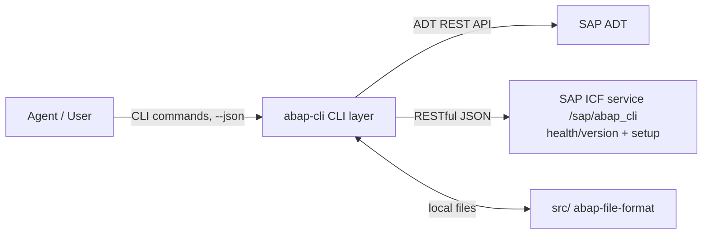

# Architecture

abap-cli follows a three-layer design with clear separation of responsibilities.

## The Three Layers

| Layer | Directory | Language | Responsibility |
|-------|-----------|----------|----------------|
| **CLI** | `src/abap_cli/` | TypeScript | Thin client: HTTP calls to SAP, file I/O, result display |
| **SAP** | `abap/` | ABAP | ICF service handlers (health/version endpoint now; DDIC CRUD next) |
| **Agent** | `skills/` + `agents/` | Markdown | Skill prompts and multi-step workflow orchestration |



## CLI Layer (`src/abap_cli/`)

```
src/abap_cli/
├── index.ts              # commander entry point, registers all commands
├── clients/
│   ├── adt-client.ts     # AdtClientWrapper — thin wrapper over abap-adt-api
│   ├── icf-client.ts     # ICF service client (DDIC, later phase)
│   └── probe.ts          # layer-by-layer connection probe (tls → auth → adt → icf)
├── commands/             # one file per CLI command — thin: parse args, delegate to flows/, print result
├── config/               # .abap.json + user system profiles, keychain (secrets.ts), profile export/import
├── core/                 # shared infrastructure: lazy registration, polyfill, object/transport resolution, limits
├── dictionary/           # DDIC domain logic: ddic-json.ts (abap-file-format JSON ↔ wire mapping)
├── formats/              # abap-file-format file resolution + pull strategies
├── clients/icf-version.ts # ICF service version + deployment check
├── textpool/             # textpool capability probe + mixed-mode route (ADT/ICF)
├── output/               # unified JSON output (CliError/printResult/printError), error/exit codes, help text, check-issue types — see output/README.md
└── flows/                # workflow orchestration, grouped by area
    ├── edit/             # pull / push / create coordinators + per-type modules
    ├── setup/            # init, profile, doctor, command-schemas, deploy helpers
    ├── search/ data/ mime/   # search, SE16N-style data, MIME repository
    └── …                 # config, connection, status/diff/inspect, atc, run, select
```

### Key decisions

- **ADT via `abap-adt-api`** — source objects (Class/Interface/Program/Function Group) use the standard ADT REST API: search, object structure, source GET/PUT, lock/unlock, content-based syntax check, activation, object creation, transport management, usage references (`where-used`).
- **Thin client** — the CLI only orchestrates HTTP calls and file/result handling; business logic stays on the SAP side.
- **Unified output** — every command uses `output/json.ts` (`printResult`/`printError`) so `--json` output is consistent across commands and parseable by agents. `OutputMode` is `'human' | 'json' | 'pretty-json'`; `--json` is compact (token-efficient), `--pretty-json` is indented. `stripEmpty()` recursively trims empty `{}` / `[]` from `data` in JSON modes.
- **Workflow orchestration** lives in `flows/edit/`: one coordinator per command plus per-type modules. `create.ts` (dispatcher) with `create-{ddic,http,tran,ttyp,msag,ddls}.ts`, `create-local.ts`, `create-fugr-func.ts`, `create-schema.ts`; `pull.ts` with `pull-{source,ddic,http,transport,textpool,remote,package,tr,ttyp,msag,ddls,srvd,bdef,cds-extension}.ts`; `push.ts` with `push-object.ts`, `push-fugr.ts`, `push-textpool.ts`, `push-{ttyp,msag,ddls}.ts`; `activate.ts` (inactive-item activation); `deploy-flow.ts` (deploy + status); plus `run-flow.ts` (classrun / wrapper static method), `select-flow.ts` (SE16N equivalent), `tcode-flow.ts` (TSTC → TSTCT), `where-used-ops.ts`, `search-flow.ts` (ADT quickSearch paging/filters), `status.ts`, `diff.ts`, `inspect-ops.ts`, `doctor-checks.ts`, `atc.ts`, `core/check.ts` (syntax / content / ATC validation). Shared resolution lives in `core/`: `core/resolve.ts` (object URL + parts resolution, packageName from the search hit), `core/transport.ts` (`resolveTransport`: `--tr` > config > user's open request > error). `push.ts` resolves the transport **per object** (`transportInfo` binding first, `$TMP` free). Commands stay thin: they parse arguments and print the `{ data, human }` result the flow returns.
- **AFF JSON artifacts share one contract** — `formats/artifact.ts` defines `JsonArtifact<TLocal>` (read / write / validate / load) and `WireArtifact<TLocal, TWire>` (+ `toWire` / `fromWire`).
  The five pure-JSON artifact modules (TTYP / MSAG / DDLS / ENQU / NROB) declare their artifact with `defineJsonArtifact` / `defineWireArtifact` instead of repeating the same file+schema plumbing;
  DDLS keeps a bespoke asymmetric wire mapping (the source lives in the sibling `.acds`). The routing table's `aff-json` validator consumes the same artifacts.
- **Type routing is one explicit table** — `flows/edit/routing.ts` holds `TYPE_ROUTES`, one row per supported type, with the create / pull / push route and the channel each operation uses (`adt`, `icf`, or `auto` = channel detection picks ADT vs ICF per SAP release). `kind: 'source'` means the coordinator's generic ABAP-source path handles the operation; `kind: 'handler'` carries the per-type flow function. `types/registry.ts` stays the single source for local-layout metadata (`folder` / `createObjtype` / AFF schema / `requiresFile`); a consistency test (`test/unit/routing.test.ts`) fails when the two tables drift.
  - `create` / `pull` / `push` dispatchers do exactly one table lookup instead of if-chains. Artifact pushes are split by file kind: `icf-json` routes post through the ICF service (`push-icf.ts`, DDIC / HTTP / TRAN), `aff-json` routes are AFF documents whose flow runs channel detection (TTYP / MSAG / DDLS / NROB), `source` routes use the generic ADT source push.
  - `create` fail-fast for `--file`-only types and the `create --schema` contract both read `ObjectTypeEntry.requiresFile` (`requiresFileFor` / `typesRequiringFile`).

## SAP Layer (`abap/`)

The bundled ICF service lives under `abap/src/clas/` (the same lowercase-type layout used by the CLI pull destination):
- **`ZCL_ABAP_VIBE_ICF`** — HTTP handler (`IF_HTTP_EXTENSION`) for `/sap/abap_cli/`: root path returns a unified JSON envelope with service id + version; unknown paths / methods return unified error JSON.
- **`ZCL_ABAP_VIBE_ICF_SETUP`** — `IF_OO_ADT_CLASSRUN` runner that idempotently creates/binds/activates the SICF node via the standard `CL_ICF_TREE` API (ADR gap: SICF config is not covered by ADT REST).
- **`ZCL_ABAP_VIBE_RUNNER`** — reflection-based wrapper invoked by `abap run --method <name>` to call PUBLIC STATIC methods on arbitrary classes and serialise the `RETURNING` value.
- **`ZCL_ABAP_VIBE_TABL_FORMAT`** — generates abap-file-format three-piece layouts for `TABL` (canonical `tabl.json` + `tabl.ddic` + `tabl.settings.json`); STRU emits the two-piece variant.

Endpoints exposed under `/sap/abap_cli/` (current service version `1.0.0`, see `src/abap_cli/clients/icf-version.ts`):

| Endpoint | Used by |
|---|---|
| `/` (root, version probe) | `abap deploy status`, `abap init` ICF check |
| `/ddic/<type>` (POST/GET — `DOMA`/`DTEL`/`TABL`/`STRU`) | `abap create` / `abap push` / `abap pull` for DDIC |
| `/http/<name>` (POST/GET — HTTP service) | `abap create HTTP` / `abap push <file>.http.json` / `abap pull --type HTTP` |
| `/textpool/*` (GET read; POST stub) | `abap pull --textpool` (read) on systems without ADT text-elements support. The POST branch unconditionally returns `TEXTPOOL_WRITE_UNSUPPORTED`: textpool write needs the ADT text-elements write endpoint and is unavailable on releases that only expose the non-interactive API (verified on A4H) |
| `/tcode/<code>` (GET) | `abap tcode` (TSTC → TSTCT) |
| `/version-source` (POST) | `abap pull --remote <system>` (TMS RFC destination) |
| `/data/query` (POST) | `abap select --table <name>` (SE16N equivalent, read-only) |

`abap deploy` pushes the bundled sources then triggers the setup class; `abap deploy status` / `abap init` check deployment state/version. JSON generation on the SAP side is unified on `/ui2/cl_json=>serialize` — about 74 handcrafted JSON concatenations across the ICF handler / runner / setup classes were replaced. Development of this layer follows the **Dogfooding** principle — it is itself developed via the CLI's create → pull → edit → push loop.

## Agent Layer (`skills/` + `agents/`)

Markdown prompts that orchestrate the CLI for AI agents:

- `skills/` — 6 个随包 skill（`abap-cli` meta 路由 + setup / search / edit / data 四个领域 + performance 方法论）；每个 skill 自包含 `SKILL.md + references/ + scripts/ + assets/`
- `agents/` — 多步骤工作流 agent（`abap-developer.agent.md`）

Agents drive everything through CLI commands with `--json`, never through interactive prompts (see `AGENTS.md`).

## Design Principles

The project's repo-level contract lives in the root `AGENTS.md`; the durable design principles are:

1. **Agent-First** — everything callable via CLI, `--json` output, no interactive dependency
2. **Three-layer separation** — responsibilities kept clean
3. **abap-file-format** — local files follow SAP conventions
4. **Minimal viable scope first** — start with core object types
5. **SAP-side consistency** — ICF services follow SAP standards, unified JSON responses
6. **Security & credential isolation** — credentials never in version control
7. **Dogfooding** — SAP-side ICF code is developed using the CLI itself
