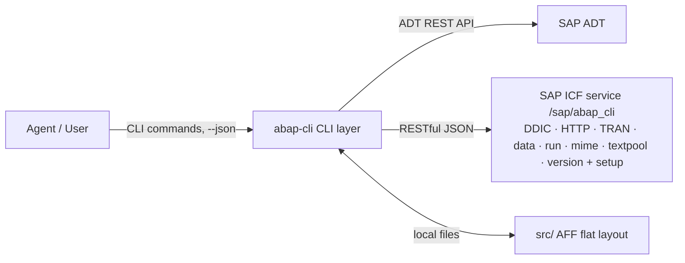

# Architecture

abap-cli follows a three-layer design with clear separation of responsibilities.

## The Three Layers

| Layer | Directory | Language | Responsibility |
|-------|-----------|----------|----------------|
| **CLI** | `src/abap_cli/` | TypeScript | Thin client: HTTP calls to SAP, file I/O, result display |
| **SAP** | `abap/` | ABAP | Bundled ICF service under `/sap/abap_cli`: DDIC + HTTP + TRAN CRUD, table data query, report runner, MIME repository, textpool read, version source, setup |
| **Agent** | `skills/` + `agents/` | Markdown | Skill prompts and multi-step workflow orchestration |



## CLI Layer (`src/abap_cli/`)

```
src/abap_cli/
├── index.ts              # commander entry point: global options + lifecycle hooks (lazy command registration)
├── top-error.ts          # top-level commander error routing (--json safe)
├── registry/             # commands.ts (single command list) + lazy.ts (lazy command stubs)
├── commands/             # one file per CLI command — thin: commander declaration + SCHEMA + print
├── flows/                # workflow orchestration, grouped by area
│   ├── edit/             # create / pull / push / deploy / activate coordinators + per-type modules
│   ├── setup/            # init, profile, doctor, command schemas, type catalog
│   ├── search/ data/ mime/   # search, SE16N-style data, MIME repository
│   └── core/             # cross-flow helpers: ATC, check, transport ops, stuck reports
├── formats/              # abap-file-format: file resolver + pull strategies + shared AFF artifact contract
│   └── ddic/             # DDIC wire / io / validate / examples (split from the former 880-line json.ts)
├── types/                # TYPE_REGISTRY — object-type metadata single source of truth
├── clients/              # AdtClientWrapper (abap-adt-api), ICF client + version check, connection probe, basic auth
├── config/               # .abap.json + user system profiles, keychain (secrets.ts), CA, profile export/import
├── session/              # session reuse, cookie / key policy
├── core/                 # cross-layer utilities: object/transport resolution, limits, path output, confirmation
├── aff/                  # vendored AFF schema resolution + validation
├── adc/                  # ADT Deployment Channel runtime probe + ICF register strategies
├── schema/               # vendored abap-file-format JSON schemas (copied into dist at build time)
└── output/               # unified JSON envelope (CliError/printResult/printError), error/exit codes, meta
```

### Key decisions

- **ADT via `abap-adt-api`** — source objects (Class/Interface/Program/Function Group) use the standard ADT REST API: search, object structure, source GET/PUT, lock/unlock, content-based syntax check, ABAP Unit runs (`test`), activation, object creation, transport management, usage references (`where-used`).
- **Thin client** — the CLI only orchestrates HTTP calls and file/result handling; business logic stays on the SAP side.
- **Unified output** — every command uses `output/json.ts` (`printResult`/`printError`) so `--json` output is consistent across commands and parseable by agents. `OutputMode` is `'human' | 'json' | 'pretty-json'`; `--json` is compact (token-efficient), `--pretty-json` is indented. `stripEmpty()` recursively trims empty `{}` / `[]` from `data` in JSON modes.
- **Workflow orchestration** lives in `flows/edit/`: one coordinator per command plus per-type modules. `create.ts` (dispatcher) with `create-{ddic,http,tran,ttyp,msag,ddls}.ts`, `create-local.ts`, `create-fugr-func.ts`; `pull.ts` with `pull-{source,ddic,http,transport,textpool,remote,package,tr,ttyp,msag,ddls,srvd,bdef,cds-extension}.ts`; `push.ts` with `push-object.ts`, `push-fugr.ts`, `push-textpool.ts`, `push-{ttyp,msag,ddls}.ts`; `activate.ts` (inactive-item activation); `deploy-flow.ts` (deploy + status) with `deploy.ts` (bundled-source assembly) and `deploy-merge.ts` (release-form merger); plus `run-flow.ts` (classrun / wrapper static method), `select-flow.ts` (SE16N equivalent), `tcode-flow.ts` (TSTC → TSTCT), `where-used-ops.ts`, `search-flow.ts` (ADT quickSearch paging/filters), `status.ts`, `diff.ts`, `inspect-ops.ts`, `doctor-checks.ts`, `atc.ts`, `core/check.ts` (syntax / content / ATC validation), `core/unit-test.ts` (ABAP Unit run: level validation, flags, summary + failures projection). Shared resolution lives in `core/`: `core/resolve.ts` (object URL + parts resolution, packageName from the search hit), `core/transport.ts` (`resolveTransport`: `--tr` > config > user's open request > error). `push.ts` resolves the transport **per object** (`transportInfo` binding first, `$TMP` free). Commands stay thin: they parse arguments and print the `{ data, human }` result the flow returns.
- **AFF JSON artifacts share one contract** — `formats/artifact.ts` defines `JsonArtifact<TLocal>` (read / write / validate / load) and `WireArtifact<TLocal, TWire>` (+ `toWire` / `fromWire`), with optional `beforeWrite` (pre-write schema gate) and `validate` overrides.
  The seven AFF JSON format modules (TTYP / MSAG / DDLS / ENQU / NROB / HTTP / TRAN) declare their artifact with `defineJsonArtifact` / `defineWireArtifact` instead of repeating the same file+schema plumbing; HTTP/TRAN use `beforeWrite` to keep their validate-before-write contract (CLI envelope stripped first).
  DDLS keeps a bespoke asymmetric wire mapping (the source lives in the sibling `.acds`); DDIC is the remaining format module with custom sidecar I/O. The routing table's `aff-json` validator consumes the same artifacts.
- **Type routing is one explicit table** — `flows/edit/routing.ts` holds `TYPE_ROUTES`, one row per supported type, with the create / pull / push route and the channel each operation uses (`adt`, `icf`, or `auto` = channel detection picks ADT vs ICF per SAP release). `kind: 'source'` means the coordinator's generic ABAP-source path handles the operation; `kind: 'handler'` carries the per-type flow function. `types/registry.ts` stays the single source for object-type capability metadata (`createObjtype` / AFF schema / `requiresFile`); local file paths are not registered there — AFF artifacts are written flat as `<rootDir>/<name>.<type>.<ext>`. A consistency test (`test/unit/routing.test.ts`) fails when the two tables drift.
  - `create` / `pull` / `push` dispatchers do exactly one table lookup instead of if-chains. Artifact pushes are split by file kind: `icf-json` routes post through the ICF service (`push-icf.ts`, DDIC / HTTP / TRAN), `aff-json` routes are AFF documents whose flow runs channel detection (TTYP / MSAG / DDLS / NROB), `source` routes use the generic ADT source push.
  - `create` fail-fast for `--file`-only types and the `create --schema` contract both read `ObjectTypeEntry.requiresFile` (`requiresFileFor` / `typesRequiringFile`).

## SAP Layer (`abap/`)

The bundled ICF service under `/sap/abap_cli` is maintained in two forms generated from the same sources.

**Development tree** — `abap/src/` keeps the service as 19 normal global classes, in the same abap-file-format flat layout the CLI writes (one `<name>.clas.abap` holding definition + implementation, plus a canonical `<name>.clas.json` per class; there are no per-type or per-object directories):

- **`ZCL_ABAP_VIBE_ICF`** — HTTP handler (`IF_HTTP_EXTENSION`): a thin front controller that dispatches `/ddic/*`, `/http/*`, `/tcode/*`, `/tran/*`, `/textpool/*`, `/data/*`, `/run/*`, `/mime/*`, `/version-source*`, `/_class-check*` into the helper classes below. The root path returns a unified JSON envelope with service id + version; unknown paths / methods return unified error JSON.
- **`ZCL_ABAP_VIBE_ICF_TYPES`** — the shared types (~100 `ty_*` / `tt_*`) in its PUBLIC SECTION; every helper class references them as `zcl_abap_vibe_icf_types=>…`.
- **Ten domain helpers** — `ZCL_ABAP_VIBE_ICF_{RESPONSE,MIME,HTTP,DDIC,TEXTPOOL,TCODE,DATA,FIELDS,VERSION,RUN}`: JSON envelope + error responses, MIME repository, HTTP service nodes, DDIC CRUD, textpool read, transaction code / transaction, table-data query, table field lookup, version source, report runner.
- **Five format renderers** — `ZCL_ABAP_VIBE_{TABL,TTYP,MSAG,ENQU,NROB}_FORMAT`: abap-file-format renderers for the ICF read paths of the dual-channel / DDIC types (`TABL` generates the three-piece canonical layout `tabl.json` + `tabl.ddic` + `tabl.settings.json`; `STRU` emits the two-piece variant).
- **Standalone classes (never merged)** — `ZCL_ABAP_VIBE_ICF_SETUP` (`IF_OO_ADT_CLASSRUN` runner that idempotently creates/binds/activates the SICF node via `CL_ICF_TREE`; ADR gap: SICF config is not covered by ADT REST) and `ZCL_ABAP_VIBE_RUNNER` (reflection-based wrapper for `abap run --method`: calls PUBLIC STATIC methods on arbitrary classes and serialises the `RETURNING` value).
- `ZCL_ABAP_VIBE_ICF_MIME` also carries a small definitions prelude (`TYPE-POOLS: skwf, wbmr.`) for the SAP type-pool types it uses.

**Manifest** — `abap/deploy.json` (next to `abap/src`, deliberately outside the AFF tree) is the single source of truth for roles: `handler`, `merged[]` (development global class → release `lcl_*` local name, in stable base order), `standalone[]`. A class in `abap/src` that the manifest does not list fails the deploy.

**Release form** — `abap deploy` (default) installs 3 global classes: the handler (main + generated definitions / implementations), `ZCL_ABAP_VIBE_ICF_SETUP` and `ZCL_ABAP_VIBE_RUNNER`. The 16 merged helpers are downgraded to `lcl_*` local classes and folded into the handler's two includes in dependency order; `zcl_*` references in the handler main are rewritten to the matching `lcl_*` names. The merge is a pure string module (`src/abap_cli/flows/edit/deploy-merge.ts`): manifest validation, class-header downgrade, word-boundary rename, stable dependency topological sort, deterministic output, and a leftover-global-name guard. The generated includes are never committed.

**Development form** — `abap deploy --dev` installs all 19 classes as global objects in dependency order (shared types first, format renderers before the DDIC helper, the handler after every helper, setup / runner last) and skips the merge. Maintainers use it to iterate on a single class on a real system, where each class can be syntax-checked, activated and run on its own. The two forms coexist on one system: the release form uses `lcl_*` locals, the development form uses `zcl_*` globals, and only the handler name is shared — whichever form was deployed last owns its three parts.

Endpoints exposed under `/sap/abap_cli/` (current service version `1.0.0`, see `src/abap_cli/clients/icf-version.ts`):

| Endpoint | Used by |
|---|---|
| `/` (root: service id + version) | `abap deploy status`, `abap init` (ICF check), `abap doctor` |
| `/ddic/<type>` (GET/POST) | `DOMA` / `DTEL` / `TABL` / `STRU` + `ENQU` / `NROB`: `abap create` / `push` / `pull` |
| `/http/<name>` (GET/POST) | HTTP service node: `abap create HTTP` / `abap push <file>.http.json` / `abap pull --type HTTP` |
| `/tran/<code>` (GET/POST) | transaction code (SE93): `abap create TRAN` / `push` / `pull` |
| `/tcode/<code>` (GET) | `abap tcode` (TSTC → TSTCT) |
| `/textpool/<category>` (GET read; POST stub) | `abap pull --textpool` read. The POST branch returns `TEXTPOOL_WRITE_UNSUPPORTED`: textpool write needs the ADT text-elements write endpoint and is unavailable on releases that only expose the non-interactive API (verified on A4H) |
| `/data/query`, `/data/find-tables-by-fields` (POST) | `abap select --table`, `abap fields --find` |
| `/run/report` (POST) | `abap run-report` (report list output) |
| `/mime/<resource>` (GET/POST/PUT/DELETE) | `abap mime create` / `delete` / `push` |
| `/version-source` (GET) | `abap pull --remote <system>` (TMS RFC destination) |
| `/_class-check` (GET) | diagnostic / activation probe (no CLI caller in this repo) |

`abap deploy` pushes the release form then triggers the setup class; `abap deploy --dev` pushes the development form and skips the merge; `abap deploy --diff` reports whether the installed form already matches (idempotency check). `abap deploy status` / `abap init` check deployment state/version. JSON generation on the SAP side is unified on `/ui2/cl_json=>serialize` — about 74 handcrafted JSON concatenations across the ICF handler / runner / setup classes were replaced. Development of this layer follows the **Dogfooding** principle — it is itself developed via the CLI's create → pull → edit → push loop, with `abap deploy --dev` providing the single-class development form on a real system.

## Agent Layer (`skills/` + `agents/`)

Markdown prompts that orchestrate the CLI for AI agents:

- `skills/` — 6 个随包 skill（`abap-cli` meta 路由 + setup / search / edit / data 四个领域 + performance 方法论）；每个 skill 自包含 `SKILL.md + references/ + scripts/ + assets/`
- `agents/` — 多步骤工作流 agent（`abap-developer.agent.md`）

Agents drive everything through CLI commands with `--json`, never through interactive prompts (see `AGENTS.md`).

## Design Principles

The project's repo-level contract lives in the root `AGENTS.md`; the durable design principles are:

1. **Agent-First** — everything callable via CLI, `--json` output, no interactive dependency
2. **Three-layer separation** — responsibilities kept clean
3. **abap-file-format** — local files follow SAP conventions
4. **Minimal viable scope first** — start with core object types
5. **SAP-side consistency** — ICF services follow SAP standards, unified JSON responses
6. **Security & credential isolation** — credentials never in version control
7. **Dogfooding** — SAP-side ICF code is developed using the CLI itself
